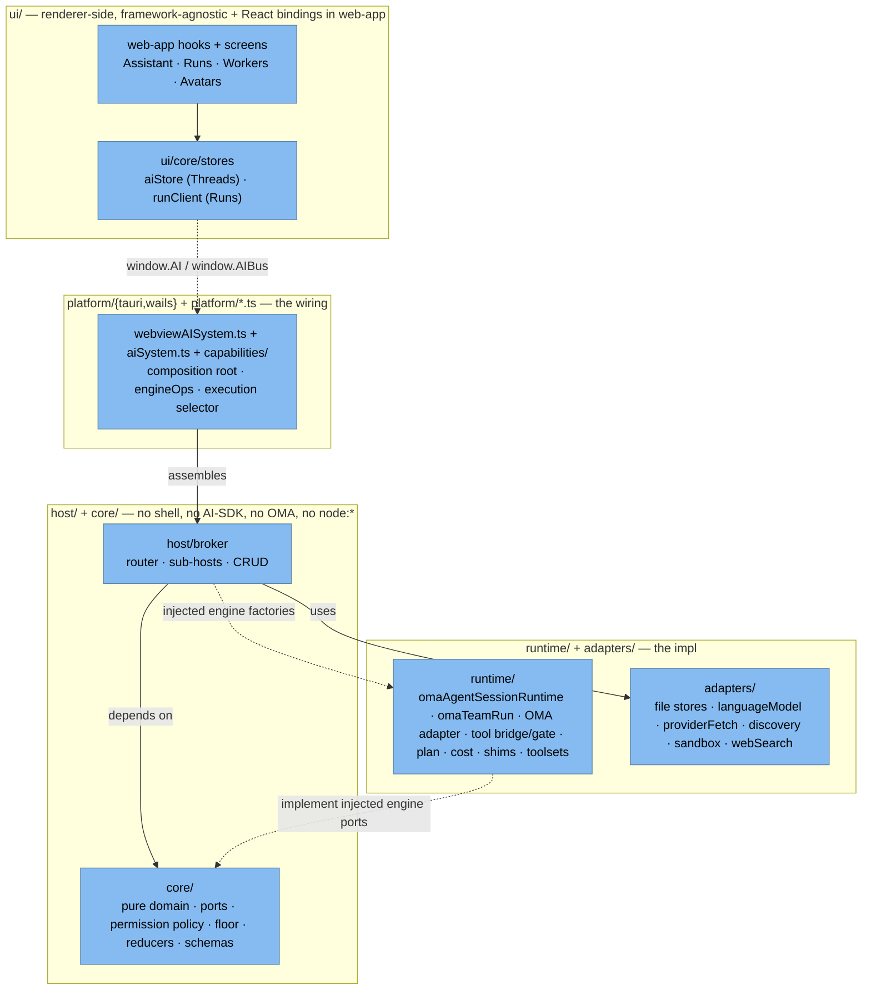
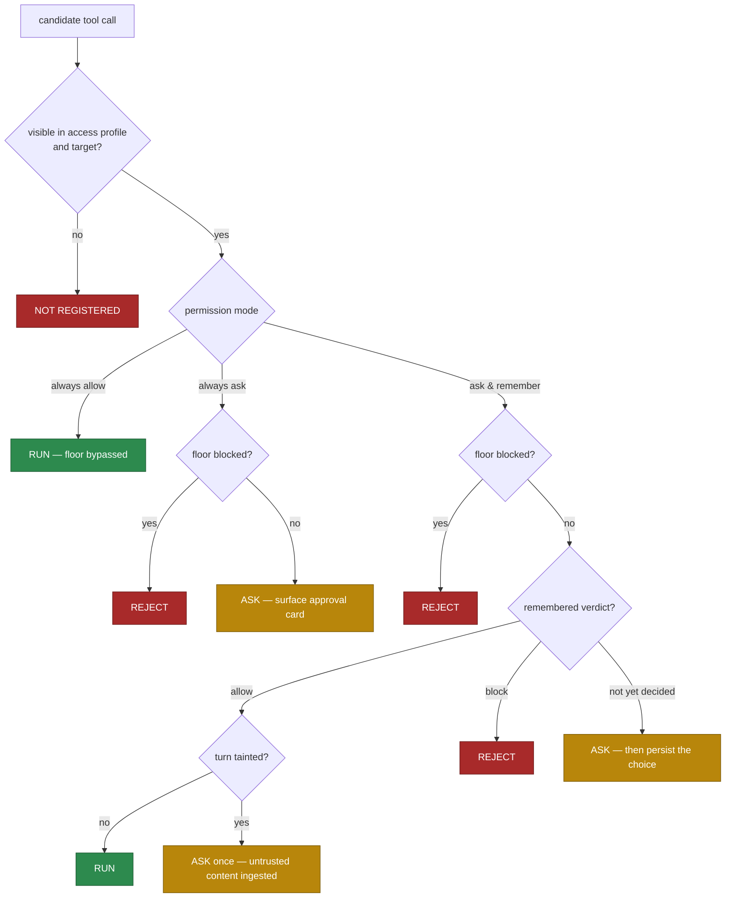

# AI subsystem

A **local-first** AI assistant for your container engines. It has grown from a single Thread into three
surfaces that share one broker, one permission model, and one provider stack:

- **Assistant** — an always-agentic thread that inspects and operates your engines through typed
  tools, gated by a permission mode you choose.
- **Runs** — give a goal, get a **plan**, and a roster of specialized **workers** carries it out as a
  dependency-ordered multi-agent run, projected live as a task-graph canvas + span waterfall with native
  token/cost telemetry.
- **Workers** — a reusable library of specialized agents (model · specialty · avatar · toolset · **where
  they run**) that Team Runs draw their roster from.

It is an expert in the Podman, Docker and Apple Container engines across local, SSH-remote, WSL and
Lima/Colima access.

**There is no process boundary to lean on.** Both shells are single-realm: the broker, the engines and the
run loops all execute inside the **webview realm**, which is therefore explicitly trusted. The renderer does
not gate anything — the broker does — but broker and renderer share one realm, so this is a weaker isolation
story than a two-process split, and the tool-permission model below is what actually holds the line.

**Provider keys and HTTP differ per shell, and the difference is a real security difference:**

| Shell | Provider transport | Where the key lives |
| ----- | ------------------ | ------------------- |
| **Tauri** | native, in Rust ([`provider_transport.rs`](../../src-tauri/src/provider_transport.rs)) — the webview names a provider and endpoint, Rust streams the response back over a `Channel` | resolved from the OS keychain **in Rust** and attached there, so the plaintext key **never enters the JavaScript realm** |
| **Wails** | the webview's standard `fetch` ([`fetchProviderTransport.ts`](../../src/packages/platform/src/providerTransport/fetchProviderTransport.ts)) | read from the keychain into the webview realm, so it depends on provider CORS and streaming compatibility |

Bringing Wails up to the Rust model means adding a Go provider-transport service; until then, treat Tauri as
the shell with the stronger key-handling guarantee. The tool-permission model applies on both regardless.

Tool execution is **consent, not a sandbox.** Once data reaches the configured provider — or if a local
model is compromised before it is run — the app cannot truly contain it. The selected provider configuration
determines that destination; the auditable, user-managed allow/reject record separately controls what tools
may run.

## Architecture: ports & adapters

The subsystem is a self-contained workspace package at **`src/packages/ai-system/src/`**, layered so the core
logic is runtime-agnostic and unit-testable without a shell or the AI SDK. Layers contract through **ports**
(neutral interfaces in `core/`), not imports. There are **no barrels / index aggregators / re-exports** — every
type has a single origin and is imported from its defining module.

| Layer | Path | May import | Responsibility |
| ----- | ---- | ---------- | -------------- |
| **core** | `core/` | nothing impure (no `node:*`, `@tauri`/`@wailsio`, react, AI SDK, OMA, sibling layers) | pure protocol, domain types, permission policy, command floor, plan/run reducers, channel + Zod schemas |
| **adapters** | `adapters/` | `core/` + impure infra | file stores, language-model construction, provider fetch, model discovery, sandbox exec, web search |
| **host** | `host/` | `core/` + `adapters/` (never `runtime/`) | the broker + sub-hosts that compose stores and injected engines |
| **runtime** | `runtime/` | `core/` + the AI SDK + `@open-multi-agent/core` | OMA Agent Session/Team Run engines, provider adapter, tool bridge/gate, plan validation, webview shims, cost estimators, toolsets |
| **ui** | `ui/core/` | `core/` | renderer-side Zustand stores + view logic (framework-agnostic; React bindings live in `web-app`) |
| **testing** | `testing/` | everything (dev/test only) | scripted mocks for `CONTAINER_DESKTOP_MOCK=1` |

**Dependency direction is a review rule (see [`CLAUDE.md`](../../CLAUDE.md)):** `core/` and `host/` MUST NOT
import `runtime/`. The engine factories (`createAgentSession`, `createTeamRun`) are **injected** into
`createAISystem` precisely so `@open-multi-agent/core` never enters the `core`/`host` graph.

`core/` defines the neutral ports — `EngineOps`, `IWorkspaceAccess`, `ConnectionExecHost`,
`ExecutionSelector`, `CreateAgentSession`, `CreateTeamRun`, `PermissionsStoreLike`, the store ports — plus the
**pure permission policy** (`permissions.ts`) and the **command floor** (`commandFloor.ts`). `host/broker.ts`
validates senders, registers channel handlers, and fans out into the sub-hosts. The shared
`platform/webviewAISystem.ts` is the composition root: it assembles the broker (or scripted mocks) and injects
the shell surface (in-realm transport, keychain, app paths, sender guard, engine factories, execution
selector). Each shell's `platform/{tauri,wails}/aiSystem.ts` supplies only what is genuinely its own — most
notably Tauri's native provider transport.

## createAISystem — the composition root

`createAISystem` (`host/createAISystem.ts`) resolves the user-data JSON store paths
(`ai-permissions.json`, `ai-knowledge.json`, `ai-threads.json`, `ai-workers.json`, `ai-avatars.json`),
builds the file-backed stores, and assembles one `AIBroker` over injected dependencies. The broker fans out:

Thread persistence is schema v5 (`view.threadId`, access profile, reasoning level, checkpoints, compactions).
On first read, `threadFileStore` falls back to the legacy `ai-conversations.json` file and `parseThreadFile`
migrates older records in memory. The next Thread mutation writes v5 to `ai-threads.json`; the legacy file is
retained as a recovery copy.

- **Assistant Threads** → `createThreadHost` — always agentic; Threads are **durable** through
  `threadRepository` (`ai-threads.json`).
- **Runs** → `createRunHost` — a goal → plan → multi-worker run; runs are **deliberately ephemeral**
  (no disk record).
- **Workers / Avatars** → `createWorkerHost` / `createAvatarHost` — thin read-modify-write CRUD mirrors over
  their file stores. Definitions carry a tool policy and an execution target, so **writes go through the
  broker** and are never renderer-writable.
- **Model discovery** → `createModelDiscoveryHost`.

The engine factories are injected: `createAgentSession` (the live Thread engine) is **required**; `createTeamRun`
(the Team Run engine) is optional — a shell that omits it makes the Run host reject a start with a clear
error rather than falling back to anything. `CONTAINER_DESKTOP_MOCK=1` swaps real streamers/stores for
scripted mocks; the mock import is gated on a build-time constant so a production build statically drops it.

## The runtime engines (OMA)

The old AI-SDK/robot3/XState session machine and the interim app-owned loops are **retired**. Both engines run
through **`@open-multi-agent/core`** (OMA). The app never consumes OMA's free-function API — it drives an
`OpenMultiAgent` **instance** it constructs itself and injects an app-owned `LLMAdapter`, so OMA owns the
agent/tool turn loop and the app owns everything at the boundary (history, events, approval, telemetry).

- **Provider bridge** — `runtime/omaAdapter.ts` `createOmaAdapter(resolved, providerFetch)` returns an
  `LLMAdapter` backed by `new AISdkAdapter(createLanguageModel(...))` (from the `@open-multi-agent/core/ai-sdk`
  subpath). Its `chat()` drives the AI-SDK adapter's **streaming** path, forwarding `text` deltas to an
  `onToken` callback for immediate UI tokens and capturing the terminal `LLMResponse` OMA's loop expects. The
  real key stays at the host boundary; the adapter is rebuilt per turn so a mid-thread model/provider
  switch takes effect.
- **Agent Session** — `runtime/omaAgentSessionRuntime.ts` (`makeCreateOmaAgentSession` → the injected `CreateAgentSession`;
  `runtime/omaAgentSession.ts` binds the default) implements `AgentSessionPort` over a per-segment
  `OpenMultiAgent` instance and its `runAgent` runner (single-agent path, `parallelToolCalls: false`,
  `MAX_TURNS = 8`). The app retains durable structured history (`modelHistory: LLMMessage[]`), sequenced
  `ThreadEvent`s folded through `reduceThreadEvent`, approval policy, and partial-output-preserving **steering**
  (two abort controllers — one for the whole task, one for a single model segment — plus a pending-input queue
  that folds queued text into the next tool result or drains it as the next prompt).
- **Team Run orchestrator** — `runtime/omaTeamRun.ts` (`makeCreateOmaTeamRun` → the injected `CreateTeamRun`;
  `createOmaTeamRun` binds the default) implements `TeamRunPort` over an `OpenMultiAgent` instance,
  mapping the roster to `createTeam(...)` `agents` and driving `runTeam(...)` with the coordinator passed
  separately: **decompose → app plan approval → dependency-aware worker dispatch → synthesis**. OMA owns
  scheduling and `maxConcurrency` (`DEFAULT_RUN_MAX_CONCURRENCY = 3`) and enforces `maxTokenBudget`; the app
  projects progress/spans through OMA's `onPlanReady`/`onProgress`/`TraceSink` callbacks, gates tools, and
  resolves per-worker providers/execution targets. `forceOmaCoordinator` pads a short goal past OMA's
  simple-goal short-circuit so the multi-agent coordinator always runs.
- **Plan validation** — `runtime/omaPlan.ts` `validateOmaPlan(tasks, maxTasks, workerIds)` is the gate on the
  coordinator's proposed plan: non-empty, within `maxTasks`, unique ids + titles, every `workerId` known, every
  `dependsOn` resolvable, **no dependency cycle** (DFS), and a final `runEvent` schema check. It returns the
  first human-readable error or `null`.
- **Tool bridge** — `runtime/omaTools.ts` adapts the app's `Toolset` to OMA: `buildCustomTools` maps each spec
  to an OMA `defineTool` (carrying the real Zod schema on `llmInputSchema` to bypass OMA's bundled Zod-3
  converter — the app owns Zod 4); `makeOmaToolGate` implements OMA's `ToolCallGate` (`onToolCall`) applying the
  permission policy, command floor, cached verdicts and injection-taint; `buildOmaWorkerToolset` merges +
  filters a worker's toolset; `createOmaToolCallSideChannel` correlates OMA tool-use blocks to stable UI
  `toolCallId`s.
- **Webview shims** (`runtime/omaShim/`) — OMA's root module links Node-only integrations even when every agent
  uses the injected AI-SDK adapter, so the renderer/WebKitGTK bundle would otherwise pull in `node:*` and a
  second provider SDK stack. Four shims keep it linkable and node-free, failing loudly if a node-only path is
  actually hit: `childProcess.ts` (`spawn` always throws — OMA's built-in process tools are default-deny; the
  app injects host-driven tools instead), `crypto.ts` (browser-safe `randomUUID`/`randomBytes` for trace/task
  ids; `createHash` throws — only OMA's file-backed stores use it), `optionalProviders.ts` (OMA's bundled
  OpenAI/Azure/Anthropic/Google/Bedrock adapters stubbed to throw on construction). The WebKitGTK smoke target
  under `tests/runtime/omaShim/` proves OMA's real orchestrator runs in the webview.
- **Tool guidance** — `runtime/toolGuidance.ts` renders the model-facing catalogue from the filtered `Toolset`
  actually registered for an Agent Session or Worker. Prompts cannot advertise tools unavailable to that execution target
  or worker policy.

## Telemetry & cost (native OMA observability)

A Team Run projects OMA's native observability into the `RunView` as a **span tree + rolled-up metrics**, and
prices token usage through an application-owned cost table. Agent Sessions retain spans in memory but do **not**
estimate cost.

**Span projection.** `core/spanEvents.ts` `spanToRunEvents(record, options?)` maps each OTel-like OMA trace
record to `span-open`/`span-close` events plus optional per-task `task-metrics`. Only a **fixed attribute
whitelist** crosses (model, provider, agent, task id/title, tool, phase, token counts, retries, explicit
`oma.cost.*`) — read via typed `textAttribute`/`numberAttribute` guards. `runtime/omaTeamRun.ts` batches span
updates into `span-batch` events (flushed at `MAX_RUN_SPAN_BATCH = 64` or on a microtask); unbatched `usage`
and `task-metrics` emit directly. `core/runReducer.ts` folds them: spans upsert with running byte accounting
and are dropped past `MAX_RUN_SPANS = 20_000` or `MAX_RUN_SPAN_BYTES = 8 MiB`, incrementing
`droppedSpanRecords`; the Waterfall view pages at 500 rows and shows the omitted count. Cumulative `usage`
(input/output tokens) is **replaced, not accumulated**, so a dropped or replayed event never double-counts the
budget the token cap is enforced against.

**Cost.** `core/cost.ts` is the pure protocol: `Money`, `TokenUsage`, `ProviderCostEstimator`, and a
`CostRegistry` that dispatches `estimate(provider, usage, { model })` to a per-provider estimator and validates
the result (finite, non-negative, non-blank currency). `runtime/cost/*` supply the estimators over an
**application-owned static price table** (`defaultCostRegistry.ts`) keyed by **exact model id** — Anthropic,
OpenAI-compatible and OpenRouter map to their price sub-tables; the three local providers
(`lmstudio`/`llamacpp`/`ollama`) map to a zero-cost estimator; unlisted models stay unpriced by design.
`defaultCostRegistry` wires provider id → estimator. A Team Run uses cost twice: OMA's own `estimateCost` hook
(`makeEstimateCost`) for **budget enforcement**, and the trace-sink `estimateCost` for the **view-facing**
per-span `Money` (computed only on span close, only when tokens + model are present, priced by the agent's
configured provider). Mixed currencies never blend — `addMoney` replaces on a currency mismatch, and
`totalRunCost` yields `undefined` if a run spans more than one currency. The `RunStatStrip` surfaces the
run's status, duration, input/output tokens, total cost, and distinct worker/model/provider counts.

## The three surfaces

### Assistant

The always-agentic thread. `submit` builds an `AgentExecutionDeps` bundle (sandbox runner, knowledge
bank, web search, `engineOps`, `workspaceAccess`) and drives a `CreateAgentSession`. Each app-global
thread owns one process-lifetime session; authorized windows attach as observers and receive the same
sequenced events. Durable metadata + redacted timeline + canonical model history live in
`ai-threads.json` via `threadRepository` (private temp-file + atomic rename, serialized). On
restart, in-flight messages/tools/approvals normalize to a stopped/rejected terminal projection — nothing
resumes automatically.

### Runs

A Team Run's lifecycle (phases in `core/schemas.ts` `runPhase`): **idle → planning → awaiting-plan → running
→ synthesizing → (cancelling) → done / stopped / error**. `runHost.start` resolves the roster host-side into
`ResolvedWorker[]` — each worker gets its own provider access, bound fetch, allowed-tool set, floor scope, and
**execution backend** (see [Execution targets](#execution-targets-runs-on)) — then `createTeamRun` drives it.
OMA owns decomposition and scheduling/concurrency; the app validates the coordinator's proposed plan in
`runtime/omaPlan.ts` (`validateOmaPlan` — id/title uniqueness, resolvable `dependsOn`, worker binding, DFS
cycle check, final schema check) before surfacing the plan-approval gate. The projection fold (`reduceRunEvent`,
plus `runTaskWaves` for the graph layout) is pure in `core/runReducer.ts`. Runs are ephemeral: they live in
host memory for their duration and are not persisted.

### Workers & Avatars

A **worker** (`core/schemas.ts` `workerDefinition`) is `{ id, name, avatarId?, specialty, systemPrompt,
providerId?, model?, toolPolicy{mode, allowed[]}, execution, timestamps }`. `specialty` is what the
coordinator reads when it assigns roster members to plan tasks. The tool policy mode is `all` · `ask` ·
`granular` (an allowlist); it is authoritative for that worker but can never bypass the floor or overturn a
remembered block. Workers persist to `ai-workers.json` (`adapters/workerFileStore.ts`).

**Avatars** (`core/avatars.ts`, `core/avatarPresets.ts`) give workers a face: ten shipped presets (fixed
vivid palette, never stored) plus custom uploaded images (`avatarRecord` = id · name · byte-capped data URL),
persisted to `ai-avatars.json`. `resolveAvatar` picks preset → custom image → generated monogram.

## Toolsets — two families

Every tool family implements the engine-neutral `Toolset` interface (`runtime/tools/toolset.ts`:
`{ defs, has, gated, title, validate, run }`). There are two:

- **Container tools** (over `EngineOps`) — `runtime/tools/containerToolset.ts`. The typed container
  operations: `listContainers` / `inspectContainer` / `getContainerLogs` / `getContainerStats`, the same
  list/inspect for images, networks and volumes, and the gated mutations (`startContainer` / `stopContainer`
  / `restartContainer` / `pauseContainer` / `unpauseContainer` / `removeContainer`, `pullImage` /
  `removeImage`, `removeNetwork` / `removeVolume`). Names in `core/toolNames.ts`. They reach the real engines
  through the **`EngineOps` port**, implemented over the live `EngineDataService` in
  `platform/src/engineOpsAdapter.ts` — the same host clients + container-client adapters the rest of the app
  uses.
- **Workspace tools** (over `IWorkspaceAccess`) — `runtime/tools/workspaceToolset.ts`. File + exec on a
  confined workspace: reads `readFile` / `listDirectory` / `statPath` / `findFiles` / `searchText`, mutations
  `writeFile` / `editFile` / `removePath` / `execCommand`. Names in `core/workspaceToolNames.ts`.

`mergeToolsets` and `filterToolset` (in `toolset.ts`) combine and allowlist them. The goal orchestrator's
`buildToolset` picks a worker's execution backend, merges container + workspace toolsets from it (skipping any
absent part), then applies `filterToolset` when the worker's policy is `granular`. The interactive engine does
the same merge minus per-worker filtering. `core/workerTools.ts` (`WORKER_TOOL_CATALOGUE`) exposes each tool's
gated-ness to the editor UI without importing the specs.

## Execution targets ("Runs on")

A worker chooses **where its tools run** — not always the local host. This is the "Runs on" control in the
worker editor, and it covers four kinds (`core/schemas.ts` `workerExecutionTarget`, a discriminated union):

| Kind | Shape | Where the worker's file + exec tools act |
| ---- | ----- | ---------------------------------------- |
| **host** | `{ kind: "host" }` | the local host (fast `node:fs` workspace) — the default |
| **remote** | `{ kind: "remote", connectionId }` | a remote host reached over the connection (SSH `*_REMOTE`) |
| **container** | `{ kind: "container", connectionId, containerId }` | inside an existing container on that connection |
| **sandbox** | `{ kind: "sandbox", connectionId, image }` | a throwaway container created for the run and removed after |

There are two execution surfaces, and only one needed retargeting:

1. **Container-API ops** (`EngineOps`) were already multi-connection — a worker's are scoped to its
   `connectionId`.
2. **Workspace ops** (`IWorkspaceAccess`: file + `exec`) were host-locked. They are now retargetable: the
   host keeps the fast local `node:fs` workspace; every other target routes file operations through the
   target's exec primitive (`cat` / `tee` / `find` / `grep` / `stat` / `rm` / `mkdir`), confined to an
   isolated directory on the target.

**Resolution and lifecycle.** At run start `runHost.start` builds a run-scoped `ExecutionSelector`
(`createExecutionSelector(runId)`) and, per worker, calls `selector.select(worker.execution)` →
`ResolvedExecution { engineOps?, workspaceAccess?, floorScope, dispose }`. Results are memoized by
`executionTargetKey` (one backend per distinct target). The resolved backend is layered onto the
`ResolvedWorker`, and the orchestrator uses it. Run disposal tears down every backend once — which **removes
any sandbox container** (labelled `container-desktop.ai.sandbox=<runId>`). A resolve failure at run start
disposes anything already created and **rejects the run with a clear message — never a silent host fallback**.

The ports live in `core/ports.ts` (`ConnectionExecHost`, `ResolvedExecution`, `ExecutionSelector`,
`ExecutionSelectorFactory`); the implementations are shell-neutral, in
`platform/src/capabilities/{connectionExec,execWorkspaceAccess,executionSelector}.ts`.
`connectionExec.ts` implements `ConnectionExecHost` over `EngineDataService.getHost` — so a **remote
container** needs no fifth kind (it is simply a container/sandbox whose connection is an SSH one).

**Target-aware floor.** The safety floor scope follows the target (`floorScopeFor`): `strict` (host, remote) ·
`container` · **`sandbox`** relaxes the destructive-program denylist (the blast radius is a throwaway
container), while the structural rules (shell-metacharacters, `..`, args-array-only, valid program token)
hold in **every** scope.

**v1 limitations (intentional, documented).** Tauri/Wails run the AI in the webview realm with no Node, so
they omit `createExecutionSelector` and their workers run **host-only** — the documented fallback. Sandboxes
are created eagerly at run start for every sandbox-target roster worker (even if the plan never uses them).
File ops assume a POSIX-ish target (busybox/coreutils). `execCommand` runs in the target's default cwd
(a sandbox pins `/workspace`; an existing-container / remote uses the container/SSH default dir).

## The permission system

Access and approval are separate authorities:

- A Thread's durable **access profile** decides which tools OMA can see.
- The app-global **permission mode** decides whether each visible gated call runs, asks, or rejects.
- The target-aware **floor** rejects structurally unsafe execution.
- A scoped allow/reject **record** can reuse an exact prior decision.

The profile filter is applied before tool definitions and tool guidance reach OMA. A prompt cannot invoke a
tool that its Thread profile does not expose:

| Profile | Effective capability |
| ------- | -------------------- |
| **Observe** | Read-only container and workspace inspection |
| **Workspace** | Read-only container inspection plus workspace reads and mutations |
| **Operator** | Every tool available on the bound execution target |

Gated tools are typed container mutations plus workspace mutations (`writeFile` / `editFile` / `removePath` /
`execCommand`) and generic command/network operations when present. Reads run without an approval prompt only
after they survive the profile, target, Worker-policy, and availability filters.

The three modes (a global preference in `AISettings.permissionMode`, default **always ask**):

- **Always ask** — every gated call surfaces an approval card; the remembered record is ignored and nothing
  is persisted.
- **Ask and remember** — a call surfaces a card **only if not already decided**; a remembered allow runs
  silently, a remembered block is rejected silently, and a fresh decision is **persisted** so that exact
  command never asks again.
- **Always allow** — no prompt, no record, **no floor**: anything runs (the most dangerous mode, an explicit
  max-trust opt-in).

The whole decision is one pure function, `resolveToolAction({ mode, floorBlocked, cached, tainted })`:

A **worker** additionally carries its own `toolPolicy` mode (`all` / `ask` / `granular`), applied by
`resolveWorkerToolAction`: it decides which tools the worker may reach and whether to ask, but it can never
bypass the floor or overturn a remembered block.

### The floor

`isFloorBlocked(command, scope)` is the only catastrophic check, enforced in **always ask** + **ask and
remember** and bypassed in **always allow**. It blocks a hardcoded denylist of destructive / privileged /
shell / network programs (`rm`, `sudo`, `ssh`, `bash`, `curl`, …), any shell metacharacter in an argument, an
invalid program token, or a `..` path-traversal segment. The **sandbox** scope lifts only the program
denylist (the target is a throwaway container); every structural rule still applies in every scope. `{` and
`}` are allowed (engine `--format '{{json .}}'` Go templates are inert without a shell); every other
metacharacter is rejected.

### The record

Remembered decisions live in the version-2 `userData/ai-permissions.json`, owned by the broker. Every rule is
bound to:

- workspace identity;
- execution target;
- authority subject (Assistant access profile, Worker, or future server);
- typed tool and optional server id;
- stable normalized arguments;
- content-trust epoch.

`permissionKey` serializes that complete decision scope; `toolRule` and `toolKey` construct typed-tool rules.
A decision made for one project, target, profile, Worker, argument set, or trust epoch cannot authorize
another. A block beats an allow for the same key. Legacy v1 files, corrupt data, unreadable files, and
wrong-version files fail closed with an empty record and force prompting rather than silently dropping a deny.
The file is managed from **Settings → AI permissions**. Mutations are serialized and written through a private
temporary file plus atomic rename, so memory changes only after persistence succeeds.

### Resolve, persist, resume

An approval that needs a person becomes an approval request the renderer resolves by id. In ask-and-remember
the engine **persists the verdict before it resumes**; if persistence fails, it fails closed and the tool does
not run. An allowed tool then executes once through its normal path — there is no broker re-execution.

## Security model

Every `ai:*` handler is wrapped by the broker, and the checks run **in order**. They execute in the explicitly
trusted single webview realm — the renderer does not gate, the broker does, but both share that realm. Treat
this as consent enforcement with an audit record, not as process isolation.

1. **Sender** — only an authorized app window may reach any handler. Thread identity is app-global and
   independent from sender identity: authorized windows attach as observers, receive the same sequenced
   events, and may route commands to that thread.
2. **Provider destination** — selecting a catalog provider or saving a custom endpoint is the explicit choice
   of where chat and model-discovery requests go. Provider IDs/models are validated, endpoint URLs must use
   HTTP(S) without embedded credentials, credential injection is bound to the configured origin, requests are
   bounded/cancellable, and missing required credentials fail before transport.
3. **Redaction** — `redactPayload`/`redactText` strip provider-key prefixes, bearer tokens, JWTs, URL creds,
   and secret-looking env assignments from everything sent to a provider **and** from every command output
   before it re-enters the model.
4. **Keys** — never in `user-settings.json`; `safeStorage`-encrypted in `ai-credentials.json` (mode 0600). On
   Linux `safeStorage` can degrade to `basic_text` (not real encryption) — the store detects it, the UI
   warns, and storing a cloud key then requires explicit opt-in.
5. **Permission mode + floor** — the gate above decides run/ask/reject. The mode is read per task; a fresh
   approval in "remember" mode persists its fully scoped verdict before execution resumes. Assistant calls
   use an access-profile subject; Team Run calls use the assigned Worker subject.
6. **Structural execution safety (every mode).** Independent of the permission decision, a command that runs
   goes through the sandbox: the tool API exposes only `{ program, args }` (a `.strict()` schema rejects a
   smuggled shell/cwd/env/wrapper); the sandbox builds the process options itself — fixed cwd, a **scrubbed
   allowlist env** (not the parent's), hard timeout, **no shell** — and spawns an **args array**. Output is
   capped and redacted. Web search is SSRF-guarded (blocks reserved/private/loopback/link-local resolved IPs,
   re-checks redirects, restricts the fetch to its fixed origin) and its query is redacted before egress. In
   "always allow" the floor is skipped, but all of this structural safety still applies.

## Provider model

One abstraction covers everything via the AI SDK. `resolveProvider` (pure, `core/providers.ts`) decides
id/kind/baseURL/model/requiresKey/discovery; `createLanguageModel` (`adapters/languageModel.ts`) turns that
into a `LanguageModel` backed by the shell-specific fetch adapter — Anthropic uses `@ai-sdk/anthropic`, OpenAI
`@ai-sdk/openai`, everything else `@ai-sdk/openai-compatible` (just a different `baseURL`). The real key is
injected inside the provider-fetch seam (`adapters/providerFetch.ts`); the SDK only ever sees a placeholder
header.

The provider catalog (`resources/ai/provider-catalog.json`) ships **nine** providers:

- **Local (no key):** **LM Studio**, **Ollama**, **llama.cpp** — loopback base URLs.
- **Cloud (needs a key):** **Anthropic**, **OpenAI**, **DeepSeek**, **GLM** (Zhipu), **MiniMax**, and
  **OpenRouter** (aggregator — many vendors behind one key, aggregated model ids split by
  `parseAggregatedModelId`).

Model discovery (`adapters/localModels.ts` `listModels`) is provider-specific and bounded: OpenAI-compatible
endpoints paginate with `after`; Anthropic uses its `anthropic-version` header and `after_id`; a single-model
server may fall back to its explicitly saved model; a manual provider performs no discovery request. The
renderer cache is TanStack Query, keyed by provider id + normalized endpoint + auth metadata + a non-secret
credential revision.

Reasoning is provider/model capability, not a generic text option. Provider-catalog metadata identifies model
prefixes that expose effort control. A Thread durably stores `default` / `low` / `medium` / `high`; the host
validates the override against its durable provider/model pair and translates supported non-default levels to
OMA `thinking`. Unsupported combinations stay at `default` and never send an invented provider option.

## Typed transport protocol

`core/channels.ts` is the single request/response/push channel map — **Threads** (submit/list/create/configure/
resolve/snapshot/dispose/cancel + `threadEvent` push), **runs** (start/cancel/approve-plan/approve-tool/snapshot/
list + `runEvent` push), **workers** (list/save/remove), **avatars** (list/save/remove), **models**
(list/cancel), **permissions** (list/remove), **keys** (has/set/clear), **status**. `threadConfigure` is the
durable idle-only path for access and reasoning changes; an active Agent Session or compaction rejects the
mutation. Only `threadEvent` and `runEvent` are push channels. Request/response types **derive from the Zod
schemas** in `core/schemas.ts` (one source of truth). The broker validates every invoke request, the client
bridge (`host/aiClientBridge.ts`) validates every response, and the bus validates every push envelope before
it reaches a reducer. Both shells reuse that one bridge over an in-realm bus — there is no per-shell client to
keep in sync.

## Renderer binding

The renderer is Zustand, split by surface:

- **Threads** — `ui/core/stores/aiStore.ts` wraps a pure-reducer runtime (`threadClientRuntime.ts` — a FIFO
  non-reentrant dispatcher over `threadClientReducer.ts`) and correlates commands to Promises. It owns
  hydration, lossless snapshot recovery, tombstones, and the Thread list; `useAIStore((s) => s.x)` is its
  read-only React projection. There is **no XState** — ordering is guaranteed by the FIFO dispatcher.
- **Runs** — `ui/core/stores/runClient.ts` is a plain closure store: a multi-run record keyed by `runId`,
  a per-run epoch guard, snapshot-channel gap recovery, and `reattach()` to re-hydrate host-held runs after a
  reload.

The store-adjacent view logic is pure and unit-tested, framework-free in `ui/core/`: `screenContext.ts` +
`resourceContext.ts` (the compact model-facing "current screen"/resource summaries), `modelChoice.ts` /
`modelCatalog.ts` / `modelDiscovery.ts` (the composer's model-picker logic), `commandHistory.ts`, and
`toolTitle.ts` (tool → human title).

**Generative-UI cards** — a tool result is rendered by a typed card, not raw JSON. `components/ai/cards/`
`registry.tsx` (`ToolCard`) owns the shared running/error states and dispatches by tool name: container tools →
`ContainersCard` / `ImagesCard` / `NetworksCard` / `VolumesCard` / `LogViewerCard`, all gated mutations →
`ActionResultCard`; workspace tools → `FileCard` (read/write) / `DiffCard` (`editFile`) / `ListingCard` /
`SearchCard` (`findFiles`+`searchText`) / `ExecCard`. Anything unmapped falls back to a redacted-JSON
`GenericToolCard`. The same `ToolCard` renders inside `TaskEvidencePanel` for each Run Task's tool results.

## Screen gating & navigation

AI is **always on** — `Metadata.RequiresAI` is a surfacing tag, never an access gate (`screenVisibility.ts`:
`visibleSidebarScreens` filters on `ExcludeFromSidebar`, `aiNavScreens` on `RequiresAI`). The routes and their
metadata:

| Screen | `Screen.ID` | `Screen.Route.Path` | Surfacing |
| ------ | ----------- | ------------------- | --------- |
| Assistant (full page) | `ai.assistant` | `/screens/ai/assistant` | `RequiresAI`, `ExcludeFromSidebar` |
| Runs (list) | `ai.runs` | `/screens/ai/runs` | `RequiresAI`, **in sidebar** (`SidebarHighlight`) |
| Team Run (detail) | `ai.run` | `/screens/ai/run/$runId` | `ExcludeFromSidebar`, **not** `RequiresAI` (needs a run id) |
| Workers (library) | `ai.workers` | `/screens/ai/workers` | `RequiresAI`, `ExcludeFromSidebar` |

Navigation is: the header carries a **single AI button** (`data-action="ai-assistant"`) that toggles the
summonable Assistant console — it does **not** navigate. **Runs** is the AI hub's own highlighted **sidebar
entry**; **Workers** and the **Team Run detail** are reached from there via the AI **section tab bar**
(`ScreenHeader.tsx` `ScreenHeaderSectionsTabBar` — a Runs tab, lit for both `ai.runs` and `ai.run`, and a
Workers tab). Build hrefs only through `Run/Navigation.ts` / `Worker/Navigation.ts` (`getRunsUrl`,
`getRunUrl`, `getWorkersUrl`); `Run/index.tsx` + `Worker/index.tsx` are barrels (`ActionsMenu` /
`CreateDrawer` / `Navigation`) and register no screen — the list screens are the `ManageScreen.tsx` files.

The **Assistant console** (`web-app/components/ai/AssistantConsole/`) is a single app-wide host portaled to
`<body>` so it overlays the full app width. Its primary form is a bottom *quake* drawer opened with the quake
shortcut (mod + backtick) or the header button and dismissed with Escape (when idle). It renders the **same**
`<AssistantThread>` as the full-page Assistant against one `useAIStore` Thread, so work is continuous
across surfaces.

### The Team Run screen

`Run/RunScreen.tsx` attaches to a Run started elsewhere (it never creates one) and renders the Run projection
over a resizable split workspace: a **view switch** between an interactive DAG canvas and a span waterfall on
the left, the selected task's evidence on the right, and the synthesis "Answer" below when present. A header
token-usage `ProgressBar` (spent / budget) plus Stop, the plan-approval gate, and any pending tool-approval
prompts sit above it.

- **`RunGraphCanvas`** — the task DAG as a **React Flow** (`@xyflow/react`) canvas: `task` nodes (the task
  card with `WorkerAvatar` + status) and `waveLabel` nodes, laid out by `runGraphLayout.ts` (column per
  dependency wave), edges from `dagEdges.ts` (one bezier per real in-plan dependency). Pan/zoom/fit + click-to-
  select; nodes are non-draggable. This replaced the hand-rolled SVG overlay that stayed blank until first
  interaction.
- **`WaterfallView`** — the alternate span timeline: a Blueprint `Tree` grouped by attempt, each span a
  positioned timing bar, paged at `WATERFALL_PAGE_SIZE = 500` and surfacing `droppedSpanRecords`. Layout is
  pure in `waterfallLayout.ts` (`buildWaterfall`/`limitWaterfall`, breaking parent cycles).
- **`RunStatStrip`** — the run-level stat row (status, duration, tokens, cost, distinct worker/model/provider
  counts); math in `runStats.ts`.
- **`TaskEvidencePanel`** — the selected task's Output (markdown + each `toolResults` entry as a `ToolCard`),
  Details (`PropertyValueTable` of model/provider/tokens/cost/timing/retries), and Raw (`{ task, spans }`) tabs.

`runBoard.ts` maps a run's phase to the Runs-list board column and counts settled tasks for progress.

## Prompt templates

Every model-facing prompt and static markdown block is a `.md` file under `src/resources/prompts/`, rendered
through `renderPrompt` (Nunjucks **browser** build → node-free) or imported `?raw` — **never inlined in TS**.
The agent prompt renders a **Current screen** block from a compact model-facing summary of the screen the user
is on, plus that screen's *focus* guidance from a per-screen prompt registry (keyed by screen id, with domain
bases → sub-screen overrides → generic fallback).

## Mock mode

When `CONTAINER_DESKTOP_MOCK=1`, `testing/aiMocks.ts` supplies a spec-v3 streaming language model plus fixture
`EngineOps`, sandbox, knowledge, web, model catalog, and in-memory seeded permission / worker / avatar /
Run stores; `testing/omaMocks.ts` supplies scripted OMA adapters. The mock emits real model text/tool-call
chunks, so the production OMA runners, event stream, approval, steering, queuing, and cards all run unchanged.
The mock composition uses the in-memory `VirtualEngineHost` execution selector, keeping worker target
routing hermetic while exercising the same selection boundary.

## Source map

| Path | Role |
| ---- | ---- |
| `core/accessProfiles.ts`, `core/reasoning.ts` | pre-OMA Assistant tool filters + provider/model reasoning capability |
| `core/permissions.ts` | permission modes, scoped rule/key construction, `resolveToolAction`/`resolveWorkerToolAction`, cached verdict, injection-taint |
| `core/commandFloor.ts` | the catastrophic floor + `FloorScope` (strict/container/sandbox) |
| `core/workers.ts`, `core/avatars.ts`, `core/avatarPresets.ts` | worker helpers (`workerAllowedTools`, `floorScopeFor`, `executionTargetKey`), avatar resolution + shipped presets |
| `core/runReducer.ts`, `core/runEvents.ts` | run projection fold (spans/usage/metrics + byte accounting) + `runTaskWaves` layout, run event types |
| `core/spanEvents.ts`, `core/cost.ts` | OMA trace-record → `RunView` span projection + attribute whitelist; `Money`/`CostRegistry`/`ProviderCostEstimator` cost protocol |
| `core/{threadEvents,threadReducer,threads}.ts` | Thread event types + limits, the Thread-event reducer, Thread-view helpers |
| `core/ports.ts`, `core/types.ts` | engine/exec/workspace/store ports, shared domain types, `ResolvedWorker` |
| `core/{channels,schemas}.ts` | typed invoke/push channel map + authoritative Zod schemas (protocol source of truth) |
| `core/{providers,redact,limits,settings}.ts`, `core/{toolNames,workspaceToolNames,workerTools}.ts` | provider resolution, redaction, ceilings, settings, tool-name unions + gated catalogue |
| `adapters/{languageModel,providerFetch,localModels}.ts` | model construction, credential-stripping transport, bounded discovery |
| `adapters/{sandbox,webSearch}.ts` | scrubbed-env args-array exec, SSRF-guarded search |
| `adapters/{threadFileStore,workerFileStore,avatarFileStore,permissionsStoreCore,knowledgeFileStorage}.ts` | private temp-file/atomic-rename stores |
| `host/createAISystem.ts`, `host/broker.ts` | composition root + router / sub-host fan-out |
| `host/{threadHost,runHost,workerHost,avatarHost,modelDiscoveryHost,threadRepository,knowledgeBank}.ts` | the surfaces' hosts + durable thread coordination |
| `host/aiClientBridge.ts` | the typed `window.AI` client + bus bridge (response/push validation) |
| `runtime/{omaAgentSessionRuntime,omaAgentSessionTools,omaTeamRun}.ts` | OMA-backed Agent Session + its approval/tool controller; Team Run engine (drive an `OpenMultiAgent` instance) |
| `runtime/{omaAdapter,omaAgentSession,toolGuidance}.ts` | AI-SDK provider bridge, injected Agent Session wiring, runtime-derived tool guidance |
| `runtime/{omaPlan,omaTools}.ts` | plan validation (`validateOmaPlan`), OMA tool bridge/gate (`buildCustomTools`, `makeOmaToolGate`, side-channel) |
| `runtime/omaShim/{childProcess,crypto,optionalProviders}.ts` | webview-safe shims for OMA's node-only links |
| `runtime/cost/defaultCostRegistry.ts` | application-owned static pricing + per-provider estimators |
| `runtime/tools/{toolset,containerToolset,workspaceToolset,containerToolSpecs,workspaceToolSpecs}.ts` | the two tool families + specs + combinators |
| `ui/core/stores/{aiStore,threadClientReducer,threadClientRequests,threadClientRequestResults,threadClientRuntime,runClient}.ts` | renderer Thread state reduction, host-request effects/results, runtime/store + Runs multi-run store |
| `ui/core/{screenContext,resourceContext,modelChoice,modelCatalog,modelDiscovery,submissionHistory,toolTitle}.ts`, `ui/core/commands/*` | pure view logic: context summaries, model picker, command registry/parser/scheduling, prompt recall, tool titles |
| `testing/{aiMocks,omaMocks}.ts` | scripted mocks for `CONTAINER_DESKTOP_MOCK=1` |
| `platform/src/engineOpsAdapter.ts` | the `EngineOps` port over the live `EngineDataService` |
| `platform/webviewAISystem.ts` | the shared composition root (assemble broker / mocks; wire `engineOps`, execution selector) |
| `platform/{tauri,wails}/aiSystem.ts` · `aiSystemHost.ts` | the per-shell wiring — Tauri adds the native provider transport |
| `platform/capabilities/{connectionExec,execWorkspaceAccess,executionSelector}.ts` | connection/container exec, off-host workspace, per-run execution selector |
| `platform/{tauri,wails}/capabilities/{workspaceAccess,executeIsolated,keychain,dns}.ts` | local workspace, isolated exec, keychain, DNS — per shell |
| `ai-system/host/aiClientBridge.ts` | the one `window.AI` / `window.AIBus` mapping both shells reuse |
| `web-app/screens/AI/{AssistantScreen,ScreenHeader}.tsx` | full-page Assistant + the AI section tab bar |
| `web-app/screens/AI/Run/{ManageScreen,RunScreen,CreateDrawer}.tsx` | Runs list, Run detail, start-a-Run drawer |
| `web-app/screens/AI/Run/{RunGraphCanvas,WaterfallView,RunStatStrip,TaskEvidencePanel}.tsx` | run-detail views: React-Flow DAG canvas, span waterfall, stat strip, per-task evidence |
| `web-app/screens/AI/Run/{runBoard,runGraphLayout,dagEdges,waterfallLayout,runStats}.ts` | pure run-view logic (board columns, graph layout, edges, waterfall layout, cost/duration stats) |
| `web-app/screens/AI/Worker/{ManageScreen,CreateDrawer,WorkerModelPicker,executionTargetLabel}.tsx` | Workers library + editor + "Runs on" label |
| `web-app/components/ai/cards/` | the generative-UI card registry + cards (container + workspace + generic fallback) |

## Testing strategy

- **Pure logic, TDD** — access profiles, reasoning capability, scoped permissions (every effects cell),
  `commandFloor` (every scope), `workers`,
  `runReducer`, `spanEvents`/`cost` (attribute whitelist, price math, currency handling), `providers`,
  `redact`, `settings`, the Thread-event reducer — real behavior, no mocks, hermetic in Vitest.
- **Renderer view logic, TDD** — the Run-screen pure helpers (`runBoard`, `runGraphLayout`, `dagEdges`,
  `waterfallLayout`, `runStats`, `executionTargetLabel`) and `omaShim/crypto` under Vitest.
- **DI for host-coupled pieces** — stores/keychain use fakes; `broker`/`runHost`/`avatarHost` test channel
  routing, roster resolution, execution-backend disposal, validation/redaction, and snapshots.
- **Runtime, TDD** — the OMA Agent Session and Team Run engines through their ports (steering, tool
  boundaries, approval, DAG scheduling, plan validation, span/cost projection), the toolsets, the sandbox
  floor, and the renderer stores.
- **Adapters, TDD** — `connectionExec`, `execWorkspaceAccess`, `executionSelector`, `languageModel`,
  `localModels`, `providerFetch`, the file stores.
- **Live / CDP** — the Assistant, Runs, Workers, the permission dropdown + approval cards, and Settings → AI
  permissions are verified via the standard CDP smoke against the running dev build.
- **Real-world targets** — the execution-target matrix (host / sandbox / container / remote) is exercised
  against live engines; see [`../testing-runs-on.md`](../testing-runs-on.md).
