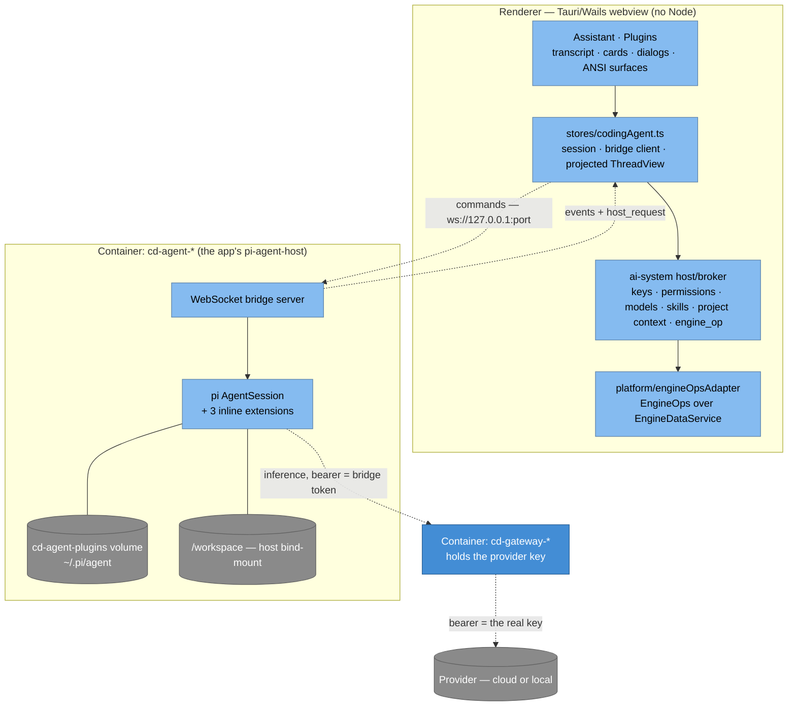

# AI subsystem

Container Desktop is a **GUI for a [pi](https://github.com/earendil-works/pi) coding agent**. pi is consumed as
a library, its terminal UI is replaced by the app's React UI, and the agent itself runs **inside a container on
one of your engine connections** — not in the webview, not in a host sidecar.

Three worlds, two of them containers:

| World | What runs there | Trust |
| ----- | --------------- | ----- |
| **Renderer** (webview) | the transcript, cards, dialogs, ANSI surfaces, the composer; the AI broker; the engine ports | explicitly trusted — there is no process boundary inside it |
| **Agent container** (`cd-agent-<id>`) | the pi session, its plugins and their code, the app's `pi-agent-host` entry | untrusted enough that the provider key never enters it |
| **Gateway container** (`cd-gateway-<id>`) | an authenticating reverse proxy that holds the provider key | holds the credential; plugin code cannot reach it |

Tool execution is **consent, not a sandbox** — but the blast radius is a disposable container with one host
folder bind-mounted, which is why the permission policy here is looser than the app's host-side floor
(see [The permission model](#the-permission-model)). Once data reaches the configured provider the app cannot
contain it; the provider is the user's choice and the allow/reject record is the auditable half.

## Shape

**Why a WebSocket.** pi's client layer is transport-neutral and node-free, and a webview speaks WebSocket on
WebKitGTK and WebView2 alike. The agent listens on a loopback-published port with a per-session bearer token,
so the app only performs operations it already has: build, run with `-p 127.0.0.1:<port>`, mount, rm. The
alternative — framed JSONL over `exec -i` — would need bidirectional streaming stdio into a container on every
shell, which the host contract does not expose. pi's own experimental `pi-server` wire format is not adopted:
it carries no extension UI, and extension UI plus render frames is most of what this bridge is for.

## Packages and layering

| Package | Runs in | Contains |
| ------- | ------- | -------- |
| **`@/pi-bridge`** | both | the wire contract only — `protocol.ts` (version 1, commands, events, host methods), `codec.ts`, `image.ts` (`agentImageTag`). No Node, no DOM, so both ends import the same types |
| **`@/pi-agent-host`** | the container (Node 24) | the bridge server, the pi session and its three inline extensions, the virtual terminal + surface registry, the plugin service, the gateway. **Excluded from the renderer graph** — bundled separately by esbuild into the image |
| **`@/ai-system`** | the renderer | `core/` (pure protocol + policy) → `adapters/` (impure infra) → `host/` (the broker), plus `ui/core/` (framework-free view logic) and `testing/` |

`@/ai-system/core/` stays dependency-free: no `@/platform`, `@/i18n`, `@/web-app`, `react`, `node:*`,
`@tauri`/`@wailsio`, and no sibling layer. **The agent engine is not in this package** — it is the pi bridge,
which is what keeps any agent library out of `core`'s graph. There are **no barrels or pass-through
re-exports** anywhere; every type has one origin. This is a review rule, not a Vitest test.

The old `runtime/` layer (the OMA agent-session and team-run engines, the plan validator, the tool bridge and
the webview shims) was deleted with the OMA engine and has no successor inside the package.

## The bridge protocol

One version constant (`PI_BRIDGE_PROTOCOL_VERSION = 1`) and three directions.

**Renderer → container** (`BridgeCommand`): `hello` (token + version), `prompt` (with pi's `steer` /
`followUp` streaming behavior), `abort`, `host_response`, `surface_input` / `surface_resize`, `set_theme`,
the plugin verbs (`plugins_list` / `_install` / `_remove` / `_update` / `_check_updates` / `_set_enabled`),
`resources_list`, `session_reload`, and `read_tool_output` (below).

**Container → renderer** (`BridgeEvent`): `ready`, `response` (settles a command), the turn stream
(`assistant_delta` / `assistant_end` / `tool_start` / `tool_update` / `tool_end` / `turn_end` / `idle` /
`error`), plugin data (`entry` from `appendEntry`, `custom_message` from `sendMessage`), rendering
(`surface_frame` / `surface_closed`), plugin management (`plugin_progress`, `plugins_changed`), and
`host_request`.

**Container → renderer → container** (`host_request` / `host_response`): the reverse call. Its `method` is one
of nine extension-UI members (`select` · `confirm` · `input` · `editor` · `notify` · `setStatus` ·
`setWidget` · `setTitle` · `setEditorText`) plus **`approval`** (the permission gate) and **`engine_op`** (one
container operation). `hostRpc` **resolves to a fallback rather than rejecting**, so silence arrives as an
explicit refusal instead of a hung agent.

`classifyHostRequest` (`core/uiRequests.ts`) is the pure routing table: dialog · approval · engine-op · chrome
· ignored. An unknown method degrades to *ignored*, so a plugin written against a newer host cannot crash the
renderer.

**Reading a truncated output.** pi caps a noisy command's output and writes the whole thing to a file *inside
the container*, naming it in the tool result's `details.fullOutputPath` — a path the card cannot open.
`read_tool_output` is that read. The path arrives from a tool result, which a plugin can author, so
`toolOutput.ts` checks it against the exact shape pi's own bash executor produces
(`<tmpdir>/pi-bash-<id>.log`, flat, no traversal) and refuses anything else rather than opening it. The read
returns the **tail**, capped at 2 MiB: a truncated command's interesting part is where it stopped.

## Starting a session

`useCodingAgentStore.start()` (`web-app/stores/codingAgent.ts`) drives `startPiAgentSession`
(`adapters/piAgentContainer.ts`) against the connection's `HostClientFacade`:

1. create a session-scoped network (`cd-agent-net-<id>`; a pre-existing one is not an error);
2. write the **gateway** env file — upstream base URL, **the provider key**, the bridge token — and run
   `<image> --mode gateway` on that network. The renderer never handles that key: it composes the file with
   `KEYCHAIN_SECRET_PLACEHOLDER` and the realm owning the vault substitutes it while writing (below);
3. write the **agent** env file — deliberately *without* the key: bridge token and port, the gateway URL, the
   model id, `/workspace`, the agent dir — and run `<image> --mode agent` with
   `--publish 127.0.0.1:<port>:8787`, the workspace bind-mount, and the plugin volume;
4. connect the WebSocket client and publish the app's theme palette **before** the first plugin frame, so no
   component paints in pi's colours and then flashes to the app's.

Env files are written privately under `~/.local/share/container-desktop/agent/`, never passed in argv.
A **scoped** engine (WSL, Lima, a podman machine) runs every command through the scope wrapper, and the
workspace path is translated with `resolveGuestPath` before it is mounted.

**User mapping.** Rootless podman maps the invoking user to container root, so the image's `agent` user
(uid 1001) needs `--userns keep-id:uid=1001,gid=1001` or the bind-mounted workspace is effectively read-only;
Docker gets no mapping. The plugin volume mount adds podman's `:U` under keep-id, without which a volume
created under an earlier mapping stays owned by the old uid and pi fails with EACCES on the *first turn*,
not at startup.

**Ports.** `pickHostPort()` is `41000 + random(4000)` with no retry — probing from the renderer was judged
worse. A collision surfaces as `failed to bind host port … address already in use` in the start log.

**Egress** is on by default (a coding agent needs package managers). `egress: false` creates the agent's network
`--internal` — an internal bridge has no gateway address, so nothing on it reaches the internet or this machine —
and attaches the gateway to a second `…-egress` network so inference still works. The agent keeps its published
bridge port either way; both networks are removed on stop.

## The agent container

`pi-agent-host/src/main.ts` starts a `WebSocketServer` on `0.0.0.0:8787` and builds one pi session per connection,
queueing frames that arrive while it is still starting. `createPiSession` (`session.ts`) assembles pi's
`createAgentSessionServices` with **three inline extensions**:

- **the gateway provider** — `registerProvider("container-desktop-gateway", { baseUrl: <gateway>, apiKey:
  <bridge token>, api: <the upstream's wire shape>, models: [<the one model>] })`, where the shape comes from
  `CD_MODEL_API` (`openai-completions`, or `anthropic-messages` for an Anthropic upstream). pi therefore never reads
  `~/.pi/auth.json` and never learns a real key. Registration is queued by the extension runtime and flushed
  by `createAgentSessionServices`, which is why services are built here rather than calling the low-level
  `createAgentSession`;
- **the permission gate** — `pi.on("tool_call", …)` asks the app for a verdict on **every** tool call and
  blocks on the answer. An unreachable app is not consent: it fails closed with the reason;
- **the container toolset** — 21 tools that call back over `engine_op`.

Settings and packages are file-backed at the mounted agent dir, so `pi install` survives a session and an
image rebuild. `projectTrusted` stays false, so pi refuses project-scoped package storage and nothing is
written into the user's workspace. **pi owns session persistence** (its own JSONL entry tree); the GUI
transcript is a projection of the event stream, which is why the app has no thread store of its own on this
path.

`initTheme()` is called for a narrow reason: pi's own components read a module-global theme that *throws*
until initialised, so a plugin building a `Markdown` or `SelectList` would crash on first render.

**The gateway** (`gateway.ts`) is the same image with `--mode gateway`. It authorizes on
`Authorization: Bearer <bridge token>`, strips the caller's credentials and every hop-by-hop header, substitutes
the real key, and forwards. Response `content-encoding`/`content-length`/`transfer-encoding` are dropped —
`fetch` already decoded the body, so echoing them makes the client try to gunzip plain text. An upstream
failure answers **502 without echoing the error**, which would contain the signed request headers.

This is a practical reading of "keys never enter the container": the key lives in *a* container, just not one
plugin code can reach — no shared filesystem, no exec, no env. Host-local models keep working because the
gateway can forward to `host.containers.internal`.

## Container tools and `engine_op`

pi runs in a container and cannot reach the engine ports, so the app's container toolset is registered
*inside* pi as thin callers and executed *by the app*.

- **In the container** — `containerToolCatalogue.ts` declares one descriptor per operation with its TypeBox
  parameter schema; `containerTools.ts` registers them and turns each call into one `engine_op` request
  (10-minute timeout, so a mutation can wait on a human). Model-facing prose lives in
  `src/resources/prompts/agent-tool-descriptions.md` and is injected, not imported, keeping markdown out of the
  unit-test graph. The tool names are **the app's own** container tool names, so a container tool arrives in the
  GUI already understood by the cards, the titles and the permission gating.
- **In the app** — `core/engineOpDispatch.ts` validates the name against `CONTAINER_TOOL_NAMES` (never
  reflected off the port, so `constructor` and friends are undispatchable), fills in the session's connection
  when the model omitted one, and calls the `EngineOps` port. `listConnections` is deliberately unscoped —
  its whole purpose is telling the model which *other* connections exist. It **never throws**: a blocked agent
  is waiting on this answer, so a failure is a value the model can act on.

`EngineOps` is implemented by `platform/src/engineOpsAdapter.ts` over the live `EngineDataService` — the same
host clients the rest of the app uses.

The 21 operations: `listConnections`; list + inspect for containers, images, networks and volumes;
`getContainerLogs`, `getContainerStats`; and the gated mutations `startContainer` / `stopContainer` /
`restartContainer` / `pauseContainer` / `unpauseContainer` / `removeContainer`, `removeImage`, `removeNetwork`,
`removeVolume`, `pullImage`.

## The permission model

One decision function for both boundaries, and a global mode the user picks
(`AISettings.permissionMode`, default **always ask**):

| Mode | Behaviour |
| ---- | --------- |
| **`ask`** — always ask | every gated call raises a card; the record is neither read nor written |
| **`remember`** — ask and remember | a card only if not already decided; a remembered allow runs silently, a remembered block is rejected **visibly**, and a fresh decision is persisted |
| **`allow`** — always allow | no prompt, no record (an explicit max-trust opt-in) |

`decidePiToolCall` (`core/piApprovals.ts`) classifies the tool, then defers to the same `resolveToolAction`
the rest of the app uses. pi's read-only built-ins (`read`, `grep`, `find`, `ls`) run unattended; everything
else — the mutating built-ins, plugin tools, MCP tools — is gated, so a tool nobody has classified is *asked*
about rather than run. The container tools take their read/mutation split from `WORKER_TOOL_CATALOGUE`, so a
tool re-gated in one place cannot stay ungated in the other.

**Two boundaries, one card.** pi asks for a verdict on *every* tool call, so a container mutation arrives
twice: once as the pre-call `approval`, once as the `engine_op` the app performs itself. Only the second can
hold the request and run it, so the **pre-call gate defers for container tools** (`boundary: "tool-call"`
returns `run`) and the `engine-op` boundary decides. Gating at the pre-call boundary instead would also be
unsound: any extension can call `engine_op` without registering a tool at all.

**The floor is deliberately not applied here.** `commandFloor.ts` assumes an args *array* and treats a shell
metacharacter as injection intent — but pi's `bash` takes a shell string, where a pipe is the tool working as
designed. Its program denylist is about blast radius on a real machine, and this agent is a disposable
container with one folder mounted: the same reasoning the floor's own `sandbox` scope already encodes.

**A rejection stops the agent.** Answering "no" and nothing else makes the model retry the same command
immediately — measured against a real model, one "no" became an approval card per second. `resolveApproval`
therefore also calls `client.abort()`, so one "no" means stop and the user can steer.

**What a card says.** `piApprovalSummary` shows the shell command, the path, or — for a container mutation —
the entity **and the connection it lands on**, filling in the session's connection when the model omitted it.
Only the *text* resolves: the call's `args` stay exactly as the agent sent them, because they are also the
identity a remembered decision is keyed on.

**The record.** Remembered decisions live in the version-2 `userData/ai-permissions.json`, owned by the broker
(private temp-file + atomic rename; a block beats an allow; a corrupt or wrong-version file fails closed to
"nothing remembered", which means asking). `piPermissionContext` scopes every pi rule to the **workspace
path** and the **engine connection** — never the per-session container names, which carry a random suffix —
under the subject `pi-coding-agent`. Managed from **Settings → AI permissions**.

## Extension UI — three tiers

The agent host binds its own `ExtensionUIContext` and reports **`mode: "tui"`**, which obliges real component
rendering; claiming it before T3 existed would have made plugins take a rich path the GUI could not serve.

**T1 — dialogs and chrome to native.** `select` / `confirm` / `input` / `editor` become blocking
request/response pairs that preserve pi's timeout and dismissal semantics; `confirm` renders as `ConfirmMenu`,
per the app's UI conventions, never a dialog. `notify` becomes a toast, `setStatus` a footer strip, `setWidget`
a strip above or below the composer, `setTitle` the session title, `setEditorText` a composer draft delivered
as `{ text, seq }` so the same text set twice still applies twice. One pending dialog at a time — pi's dialogs
are modal by nature, and the agent is parked until answered.

**T2 — structured data to native cards.** A tool result is rendered by a typed card, not raw JSON
(`web-app/components/ai/cards/registry.tsx`):

| Source | Card |
| ------ | ---- |
| container reads | `ContainersCard` · `ImagesCard` · `NetworksCard` · `VolumesCard` · `LogViewerCard` |
| container mutations | `ActionResultCard` |
| pi's built-ins | `bash` → `ExecCard`, `read`/`write` → `FileCard`, `edit` → `DiffCard`, `ls` → `ListingCard`, `grep`/`find` → `SearchCard` |
| anything else | a redacted-JSON fallback, with the plugin's own T3 surface as the card body |

pi's built-ins return their payload as **text**; their `details` carry only truncation flags. `core/piToolCards.ts`
is the single place that knows those text formats and rebuilds a card result from `(args, text, details)`.
`edit` is the one rich exception (`diff` / `patch` / `firstChangedLine`) and therefore the only diff source;
`bash` reports **no exit code** — a non-zero exit throws and arrives as an error ending "Command exited with
code N".

**T3 — components to ANSI surfaces.** A `VirtualTerminal` implements pi's `Terminal` interface, `GuiTui extends
TUI` and overrides `requestRender` so a component asking to repaint re-renders its own surface, and the surface
registry emits whole-render `surface_frame` events. The renderer paints them into xterm instances
(`components/ai/AnsiSurface.tsx`, `PluginSurfaces.tsx`), keyed by slot: per-tool call/result rows,
`ctx.ui.custom()` focus surfaces (overlay placement honoured as a floating panel), footer, header, composer
replacement, and widgets. Every slot is single-occupancy, so a plugin re-setting its footer never stacks two.
A pi theme is derived from the app's `--app-*` tokens (`web-app/themes/appPiTheme.ts` → `piTheme.ts`) and
re-published whenever engine or light/dark mode changes them.

## Plugin management

The **Plugins** screen is a face on pi's own package manager: the container resolves and installs, the screen
shows what it reports. `plugins_install` / `_remove` / `_update` / `_check_updates` / `_set_enabled` map onto a
`DefaultPackageManager` over the same settings and agent dir, with its progress callback streamed as
`plugin_progress` so an npm or git wait is legible. A change emits payload-free `plugins_changed` — the GUI
refetches rather than patching a row and drifting from what pi actually has. `resources_list` reports what the
loaded packages contribute (extensions, commands, skills, prompts), which is what fills the composer's
slash-command palette. `core/pluginCatalog.ts` turns pi's `ConfiguredPackage` entries into table rows;
`web-app/stores/pluginStore.ts` holds them.

Only **user** scope is offered. Project scope is moot while nothing in the UI chooses a workspace.

## What the broker still owns

`createAISystem` (`host/createAISystem.ts`) resolves the user-data JSON store paths, builds the file-backed
stores, and registers one `AIBroker` over the shell's transport. Every `ai:*` handler is sender-guarded, its
request validated against the Zod schema in `core/schemas.ts`, and its response validated again by
`host/aiClientBridge.ts` — one client bridge, reused by both shells over an in-realm bus.

| Group | Channels | State |
| ----- | -------- | ----- |
| status / diagnostics | `ai:status`, `ai:diagnostics` | live |
| provider keys | `ai:key:{has,set,clear}` | live |
| model discovery | `ai:models:{list,cancel}` | live |
| the permission record | `ai:permissions:{list,add,remove}` | live |
| container operations | `ai:engine:op` | live — the agent's `engine_op` lands here |
| skills | `ai:skills:*` | live |
| project context | `ai:project-context:*` | live |
| workspace changes | `ai:changes:{status,diff}` | live |
| threads | `ai:thread:*`, `ai:tool-artifact:get` | **orphaned** — no shell injects `createAgentSession`, so `submit` answers "the assistant is not available", and nothing writes a tool artifact on the pi path |

**Invoking a skill spans both worlds.** `ai:skills:invoke` **resolves and renders**, it does not submit: the
host does the fingerprint match, the project-trust check, the prompt render and the size cap, then answers with
`{ prompt, displayContent, skill, allowedTools?, initialTaint? }`. The renderer submits that through
`useCodingAgentStore.submitSkill`, which shows the command in the transcript, sends the body to the model, and
holds the skill's narrowing for the turn: a tool outside `allowedTools` is refused with a reason (the model can
adapt — this is a declared narrowing, not a user's "no", so it does not abort the turn), and `initialTaint`
suppresses remembered allows so the user sees what an unvouched-for skill asked for. The narrowing lifts on
`turn_end`.

**Execution targets.** `platform/src/capabilities/{connectionExec,execWorkspaceAccess,executionSelector}.ts`
still implement the host / remote / container / sandbox backends and are injected into the broker, but nothing
consumes them since the worker library was deleted; they survive as a capability plus the mock-only
`__aiOffHostProbe` seam that `webdriver/specs/off-host-exec.e2e.js` drives.

## Providers

`resolveProvider` (pure, `core/providers.ts`) decides id/kind/baseURL/model/requiresKey/discovery. The catalog
(`resources/ai/provider-catalog.json`) ships **eight**:

- **Local, no key** — LM Studio, llama.cpp (loopback base URLs).
- **Cloud, needs a key** — Anthropic, OpenAI, DeepSeek, GLM (Zhipu), MiniMax, and OpenRouter (an aggregator;
  aggregated model ids split by `parseAggregatedModelId`).

**Inference** runs entirely on pi's own provider layer: the renderer hands `start()` an endpoint, a model id and
the provider it came from, and everything after that is the gateway — there is no AI-SDK dependency left in the
app. Two things travel with the provider, both derived from its catalog kind in `core/piAgentEnv.ts`: the **wire
shape** pi speaks (`CD_MODEL_API`, plus the gateway base URL that shape's client expects — the Anthropic SDK
builds its own `/v1`) and the **credential shape** the gateway signs (`CD_UPSTREAM_KIND` /
`CD_UPSTREAM_AUTH_SCHEME` / `…_HEADER_NAME` / `…_USERNAME`, mirroring `providerTransport`'s
`authenticatedHeaders`: Anthropic is `x-api-key`, a keyless local server is nothing at all).
**Discovery** is live and provider-specific: `adapters/localModels.ts` `listModels` paginates
OpenAI-compatible endpoints with `after`, uses Anthropic's `anthropic-version` + `after_id`, falls back to an
explicitly saved model for a single-model server, and performs no request at all for a manual provider. The
renderer cache is TanStack Query, keyed by provider id + normalized endpoint + auth metadata + a non-secret
credential revision.

Keys never live in `user-settings.json`. They are keychain-backed per shell, and the two shells differ in a way
that is a real security difference:

| Shell | Provider transport | Where the key is resolved |
| ----- | ------------------ | ------------------------- |
| **Tauri** | native, in Rust ([`provider_transport.rs`](../../src-tauri/src/provider_transport.rs)) | in Rust — the plaintext key never enters the JavaScript realm |
| **Wails** | the webview's `fetch` ([`fetchProviderTransport.ts`](../../src/packages/platform/src/providerTransport/fetchProviderTransport.ts)) | in the webview realm, so it depends on provider CORS and streaming |

Both send the key onward to the gateway container when a session starts, so the difference is about the
discovery/diagnostics path, not the session.

**The credential never crosses into the web view — not even to reach the container.** Tauri's keychain
deliberately refuses `getKey` there, which is why the gateway env file is not written by the renderer at all:

- the host composes it with `KEYCHAIN_SECRET_PLACEHOLDER` in place of the key (`core/piAgentEnv.ts`, the one
  composer and one file format), and calls `keyStore.writeSecretFile(provider, fileName, contents)`;
- the native side (`keychain_write_secret_file` in Rust, `KeychainService.WriteSecretFile` in Go) reads the
  secret, substitutes it, writes **0600** into `<userData>/agent/`, and answers only the path. The caller names
  a FILE, never a directory, and a body without the placeholder is refused rather than written unauthenticated;
- every web-view-reachable read of that directory is refused (`host/fs.rs`, `fs_service.go`) — including a
  `rename` that would carry the file out of it. Without that, "the key never enters this realm" would be one
  `fs_read_text_file` away.

`webdriver/specs/agent-secret-file.e2e.js` proves all three against a real app.

`redactPayload` / `redactText` strip provider-key prefixes, bearer tokens, JWTs, URL credentials and
secret-looking env assignments from what is displayed and stored. Web search, when a shell can pin a
destination, is SSRF-guarded (reserved/private/loopback/link-local IPs blocked, redirects re-checked, the fetch
restricted to its fixed origin).

## Screens and navigation

AI is **always on** — `Metadata.RequiresAI` is a surfacing tag, never an access gate.

| Screen | `Screen.ID` | Route | Surfacing |
| ------ | ----------- | ----- | --------- |
| Assistant | `ai.assistant` | `/screens/ai/assistant` | `RequiresAI`, `ExcludeFromSidebar` |
| Plugins | `ai.plugins` | `/screens/ai/plugins` | `RequiresAI`, `ExcludeFromSidebar` |

Both are reached from the header AI button's menu and cross-link through the AI section tab bar
(`screens/AI/ScreenHeader.tsx`); build hrefs only with `getAIScreenUrl` (`screens/AI/Navigation.ts`).

**Assistant** is the rich surface: `components/ai/AssistantThread.tsx` renders the transcript (prose, tool
cards, approval cards, ANSI surfaces), the composer with its command palette and history, and the drawers —
context, diagnostics, skills, project context, workspace changes, branch, compaction, export. The same
component backs the summonable **quake console** (`AssistantConsole/`, portaled to `<body>`, mod+backtick),
so work is continuous across surfaces.

There is exactly ONE conversation surface. `AssistantScreen` adds only what a full page can carry — the
session summary in the header (connection, workspace, container) and the start/stop actions; everything else,
including the no-session empty state and its Start CTA, lives in `AssistantThread` so the console offers it
too. A session-less surface renders no composer at all: `submit` has no bridge client to reach.

`web-app/stores/useAIStore.ts` derives the assistant's state from the pi session store (one pi session = exactly
one thread). It declares only what the session can answer for — there is no reject-by-name list any more: what pi
can do is offered under pi's own command names, and what this architecture cannot honour is refused where the
command is defined, with the reason, instead of from inside a store three layers after the user was told it was
available.

## Mock mode

`CONTAINER_DESKTOP_MOCK=1` swaps the broker's real stores and streamers for `testing/aiMocks.ts`: fixture
`EngineOps`, sandbox, model catalog, web searcher, an every-provider-configured key store, and an
**in-memory seeded** permission store (so Settings → AI permissions is exercisable without disk writes). The
mock import is gated on a build-time constant, so a production build statically drops the whole module graph.

The session itself is mocked at the **socket**, not above it: `testing/mockPiBridge.ts` implements the same
`PiBridgeClient` and speaks the same `BridgeEvent`s, so the renderer runs its production path — projection,
cards, the approval gate, surfaces — with no engine, no container and no model. `start()` takes that branch
under `CONTAINER_DESKTOP_MOCK` and skips the container pair entirely; the renderer bootstrap starts one so the
Assistant is usable on a machine with no engine at all. Its trigger phrases are the app's long-standing ones
("restart the web container", "restart web and cache", "remove … container", "simulate an error"), and its
container reads answer from the fixture `EngineOps` through the real `engine_op` path. A spec that wants one
exact frame still pushes it through the DEV-only `window.__cdCodingAgentStore` seam.

## Building the agent image

`yarn cli agent-image [--engine podman|docker]` bundles `pi-agent-host` with esbuild into
`build/agent-image/host.mjs`, copies `support/agent-image/Dockerfile` beside it, and builds
`container-desktop/pi-agent:<version>`. pi and its friends stay **external** — pi loads extensions through jiti
at runtime, so they must resolve from the image's own `node_modules`. Markdown is loaded as text, the
bundler's equivalent of the renderer's `?raw`.

The tag is unqualified: podman displays local images with a `localhost/` prefix and docker leaves them bare, so
probe with the short name. **An image built for one engine does not exist for the other.**

## Testing

- **Pure logic, TDD** — the bridge codec, `piThreadView` projection, `piToolCards` rebuilds, `piApprovals`,
  `uiRequests` routing, `engineOpDispatch`, `pluginCatalog`, permissions, the command floor, redaction,
  providers, settings — hermetic in Vitest, no mocks of what the repo does not own.
- **Container-side, TDD** — every `pi-agent-host` module has a spec: session, host RPC, permission gate,
  container tools + catalogue, surfaces, tool surfaces, virtual terminal, UI context, plugins, resources,
  gateway, events, theme.
- **Never component tests** for React screens — UI is verified live.
- **UI over WebDriver** (`webdriver/specs/`, mock app): `extension-ui` (T1) · `pi-tool-cards` (T2) ·
  `pi-surfaces` (T3) · `pi-plugins` (management) · `pi-container-tools` (the toolset over a driven bridge).
- **Real containers, no app** — `support/pi-plugins-probe.mjs` and `support/pi-bridge-probe.mjs` run the built
  image directly.
- **Real model, real engine** — `yarn test:e2e:tauri --spec webdriver/specs/pi-container-live.e2e.js` drives a non-mock app and a real
  OpenRouter model through the container toolset, creating and removing its own throwaway container.

See [`../testing.md`](../testing.md) for how to run each of these.

## Who produces each surface

Every surface either has a producer on the pi path or is refused with a reason. Nothing is offered, accepted and
then failed from inside a store.

| Surface | Producer |
| ------- | -------- |
| Transcript, tool cards, approvals | the session's bridge events, projected by `piThreadView` |
| Project Rules + Memory (what the model receives) | the app composes the pack and sends `set_system_context`; the container appends it per turn via `before_agent_start` |
| Workspace changes, project rules discovery, project skills | host-side workspace access, bound to the RUNNING session's mounted folder (`sessionWorkspace`) |
| Public web search | the app performs it (address-pinned fetch, user's setting enforced in the broker); the container registers the tool |
| Context panel · Usage panel | the session's `request_context` and `usage` reports, plus the app's own policy (provider id, permission mode, tool gating, project sources) |
| Slash commands | the app's own catalogue for what the GUI performs; the session's `resources_list` for pi's own commands and its plugins' — under pi's names, with a reason on the ones this architecture cannot honour |
| Diagnostics | two independent answers: the app's own provider probe, and the session's own through the gateway |
| Plugins screen | the session's plugin service over the bridge |

## Source map

| Path | Role |
| ---- | ---- |
| `pi-bridge/src/protocol.ts` | the wire contract — commands, events, host methods, surface slots, theme palette |
| `pi-bridge/src/{codec,image}.ts` | frame encode/decode; the agent image tag |
| `pi-agent-host/src/{main,server}.ts` | the container entry (agent or gateway) and the bridge connection |
| `pi-agent-host/src/session.ts` | the pi session — provider, extensions, TUI, surfaces, resources |
| `pi-agent-host/src/{permissionGate,containerTools,containerToolCatalogue}.ts` | the inline extensions' substance |
| `pi-agent-host/src/{systemContext,webSearchTool}.ts` | the app's project prose as system prompt; the app-performed web search |
| `pi-agent-host/src/{piCommands,reports,providerCheck}.ts` | pi's own commands; the usage/context reports; the through-the-gateway probe |
| `pi-agent-host/src/{hostRpc,events}.ts` | reverse-call correlation with fallbacks; pi event → bridge event |
| `pi-agent-host/src/{guiTui,virtualTerminal,surfaces,toolSurfaces,uiContext,piTheme}.ts` | T1 + T3: the extension UI context and ANSI rendering |
| `pi-agent-host/src/{plugins,resources,gateway}.ts` | package management, contributed resources, the credential proxy |
| `pi-agent-host/src/toolOutput.ts` | reading back a truncated tool's full output, path-validated against pi's own shape |
| `ai-system/testing/{aiMocks,mockPiBridge}.ts` | the fixture broker deps; the scripted stand-in for the in-container session |
| `ai-system/adapters/{piAgentContainer,piBridgeClient}.ts` | the container pair's lifecycle; the WebSocket client |
| `ai-system/core/{piThreadView,piToolCards,piApprovals,piAIState,uiRequests,engineOpDispatch}.ts` | pure projection, card resolution, policy, routing, dispatch |
| `ai-system/core/piContextReport.ts` | the session's reports → the context and usage panels' shapes |
| `ai-system/adapters/sessionWorkspace.ts` | which folder host-side workspace access acts on: the session's, not Settings' |
| `ai-system/ui/core/commands/piSessionCommands.ts` | pi's own commands and its plugins' as palette entries, under pi's names |
| `ai-system/core/{permissions,commandFloor}.ts` | modes, scoped rule/key construction, `resolveToolAction`; the floor (host-side only) |
| `ai-system/core/{channels,schemas}.ts` | the typed invoke/push map and its authoritative Zod schemas |
| `ai-system/core/{providers,redact,limits,settings,toolNames}.ts` | provider resolution, redaction, ceilings, settings, tool-name unions |
| `ai-system/adapters/{localModels,providerFetch}.ts` | bounded discovery; credential-stripping transport |
| `ai-system/adapters/{projectContextFileStore,skillTrustFileStore}.ts`, `permissionsStoreCore.ts` | private temp-file / atomic-rename stores |
| `ai-system/host/{createAISystem,broker,aiClientBridge}.ts` | composition root, router, the one `window.AI` client |
| `ai-system/host/{skillHost,projectContextHost,modelDiscoveryHost,diagnosticsHost}.ts` | the live sub-hosts |
| `web-app/stores/{codingAgent,codingAgentSurfaces,pluginStore}.ts` | the session, its ANSI surfaces, the plugin table |
| `web-app/stores/{useAIStore,codingAgentSystemContext}.ts` | pi session → the Assistant UI's state; the project prose the session is given |
| `web-app/screens/AI/{AssistantScreen,AssistantActionsMenu,ScreenHeader,Navigation}.tsx` | the surface, its actions and the tab bar |
| `web-app/screens/AI/Plugins/` | the Plugins sub-screen |
| `web-app/components/ai/` | transcript, composer chrome, dialogs, ANSI surfaces, drawers, the card registry |
| `web-app/themes/appPiTheme.ts` | `--app-*` tokens → the palette the container derives a pi theme from |
| `platform/src/engineOpsAdapter.ts` | the `EngineOps` port over the live `EngineDataService` |
| `platform/src/webviewAISystem.ts`, `platform/src/{tauri,wails}/aiSystem.ts` | the shared composition root and each shell's additions |
| `support/agent-image/Dockerfile`, `support/cli/lib/agent-image.ts` | the image and how it is bundled and built |
