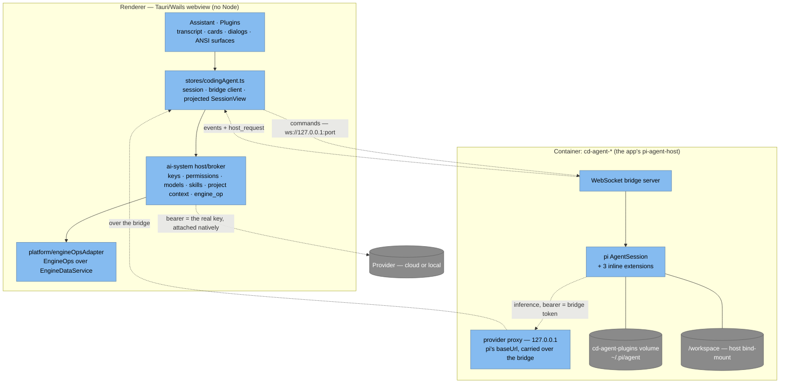

# AI subsystem

Container Desktop is a **GUI for a [pi](https://github.com/earendil-works/pi) coding agent**. pi is consumed as
a library, its terminal UI is replaced by the app's React UI, and the agent itself runs **inside a container on
one of your engine connections** — not in the webview, not in a host sidecar.

**Two nouns, never one.** In pi's own vocabulary a **session IS a conversation** — an entry tree pi persists, which a
bare `/resume` lists. This document therefore says *session* only in that sense, and calls the thing that RUNS it the
**pi-agent engine**: the container pair, one per connection. The two are not coupled the way one word for both would
suggest, and conflating them is a documented source of wrong conclusions:

| | Scope | Lifetime |
| --- | --- | --- |
| **Connection** (local engine, machine, WSL, SSH) | the root — a container and a volume exist on ONE engine only | the user's |
| **pi-agent engine** — the container `cd-agent-*` | one per connection | disposable; recreating it under the same deterministic name costs nothing |
| **`cd-agent-plugins` volume** — pi's agent dir | ONE fixed name, no per-session suffix, so it is per-ENGINE | outlives every container and every image rebuild |
| **Conversation** (pi's *session*) — an entry tree of JSONL | MANY per connection | until the user removes it |

A connection is coupled to its **pi-agent engine**, not to one conversation.

**Conversations come from this machine, not from the volume.** `<userData>/assistant-sessions` is bind-mounted at
`/home/agent/.cd/sessions` — outside the agent dir, or it would be back inside the volume — and pi is pointed at it with
`CD_SESSION_DIR`. So history survives every rebuild of the pair, is readable with nothing running, and the volume holds
only SETUP: settings, packages, trust. The HOST resolves and creates that directory (`ai:agent:sessions-dir`), because
the renderer cannot know where the app's data lives and because a bind-mount whose source is missing is created by the
ENGINE as root — which pi meets as EACCES on the first turn. It is a sibling of the protected `agent/` directory, never
inside it: that one is unreadable from the web view by design, and a user's history must not be.

The mount is shaped like the WORKSPACE mount, translated by the same `resolveGuestPath`, and deliberately carries no
`:U`: that flag belongs to a named volume left owned by an earlier mapping, while keep-id already maps the invoking user
onto the container's `agent` user. Measured against the real image, `:U` changes nothing here except making podman chown
the user's whole history on every start.

**A remote (SSH) engine is SERVED the same directory instead, and nothing is ever synced.** A remote engine mounts paths
from ITS machine — `resolveGuestPath` is the identity there by design, since the workspace folder is one the remote
already has — so `engineSharesAppFilesystem` withholds the mount. What replaces it is a storage RPC, not a copy: pi's
`SessionManager` gained a synchronous `SessionStorage` port (our own upstream patch, `support/agent-image/pi-patch`), the
container is installed with one that asks the app, and every read and write lands in the same
`<userData>/assistant-sessions` a local engine mounts. **One writer, one location, nothing reconciled** — the two modes
are exclusive by construction, since a pair either mounts the directory or asks for it.

The container asks over a **second published port** (`PI_SESSION_STORAGE_CONTAINER_PORT`), dialled by the app the same
direction as the bridge and, for a remote engine, through a second `ssh -NL` forward. That dial retries while the port
comes up, for the two reasons the bridge client already did: pi's storage worker binds a few hundred milliseconds after
`run --detach` returned, and a forward's local end is not bound the instant it is spawned. Single-shot, it took the
whole start down with "the conversation store's socket failed" while everything about the session was right. It has to be a second socket: pi's
port is synchronous — `appendMessage` returns an entry id, `create`/`open` touch the store in their constructors — so the
container's main thread BLOCKS on every call, and an answer arriving on a socket that thread is reading is an immediate
deadlock. A worker thread owns this one and hands bytes back through a `SharedArrayBuffer` with `Atomics.wait`, in
window-sized chunks (`sessionStorageChannel.ts`) so a long conversation crosses without either side buffering it whole.

The agent container is the untrusted world, so the app confines what it will act on: `resolveSessionStoragePath`
(`core/sessionStorageOps.ts`) accepts the conversations directory and the `*.jsonl` files directly inside it, and
refuses everything else with a reason — structurally, never by normalizing a traversal into something plausible. The
confinement is on the APP side deliberately: a check made inside the container is a check plugin code could edit out.
`readTextLines` carries pi's byte cap instead of its laziness, because a round trip per line would be one blocking call
per entry in the file; `appendTextFile` is a real host capability (`IFileDiscoverySystem`) because rewriting an
append-only JSONL per entry costs the square of its length.

Cost, plainly: one blocking round trip per session append, a handful per turn.

Three worlds, two of them containers:

| World | What runs there | Trust |
| ----- | --------------- | ----- |
| **Renderer** (webview) | the transcript, cards, dialogs, ANSI surfaces, the composer; the AI broker; the engine ports | explicitly trusted — there is no process boundary inside it |
| **Agent container** (`cd-agent-<id>`) | the pi session, its plugins and their code, the app's `pi-agent-host` entry, the provider proxy pi posts inference to | untrusted enough that the provider key never enters it — literally: nothing there holds one |
| **Login container** (`cd-login-<id>`) | one provider sign-in — pi's own OAuth flow, which needs a Node realm | one-shot, mounts nothing, removed on every path out |

The agent's own file tools see the container's filesystem. The **workspace toolset** (`readFile`, `listDirectory`,
`statPath`, `findFiles`, `searchText`, `writeFile`, `editFile`, `removePath`, `execCommand`) is the app's, and it acts
on the `ExecutionTarget` the session chose — a `container` it already runs, or a disposable `sandbox`
([Execution targets are containers](#what-the-broker-still-owns)). It is registered with pi ONLY
when a target was chosen (`CD_WORKSPACE_TOOLS`), because a registered tool is a promise the operation can happen; the
container is told THAT it exists and never where it lands. Calls arrive as `workspace_op`, the broker resolves one
`ExecutionSelector` per run (so a session shares one backend and one sandbox) and `dispatchWorkspaceOp` calls the
`IWorkspaceAccess` capability, which enforces workspace-root confinement inside its own implementation. Mutations are
gated at that boundary — the only one that can hold the request and run it on approval — which is why the pre-call
`tool_call` gate skips every tool the app performs. `workspaceRelease` disposes the run's targets when the session
stops; a sandbox exists for the run and nothing else.

**The built-in knowledge** (`src/resources/prompts/knowledge-bank.md`) is curated symptom / solution / commands entries
for real podman, docker, WSL and SSH failures. It is offered as `searchKnowledge` and answered INSIDE the agent
container — the entries ship in the image, so the tool asks the app for nothing. Searched rather than prompted: the
whole bank is context every unrelated turn would pay for and never read, while a tool costs nothing until the model
asks. `core/knowledgeBank.ts` parses and ranks (symptom first, then title, then the curator's id and tags), capped per
search so a vague query cannot return the whole bank. Ungated — it reads shipped data and touches nothing.

Tool execution is **consent, not a sandbox** — but the blast radius is a disposable container with one host
folder bind-mounted, which is why the permission policy here is looser than the app's host-side floor
(see [The permission model](#the-permission-model)). Once data reaches the configured provider the app cannot
contain it; the provider is the user's choice and the allow/reject record is the auditable half.

## Shape

**Why a WebSocket.** pi's client layer is transport-neutral and node-free, and a webview speaks WebSocket on
WebKitGTK and WebView2 alike. The agent listens on a loopback-published port with a per-session bearer token,
so the app only performs operations it already has: build, run with `-p 127.0.0.1:<port>`, mount, rm. The
alternative — framed JSONL over `exec -i` — would need bidirectional streaming stdio into a container on every
shell, which the host contract does not expose. pi's own experimental `pi-server` wire format is not adopted:
it carries no extension UI, and extension UI plus render frames is most of what this bridge is for.

## Packages and layering

| Package | Runs in | Contains |
| ------- | ------- | -------- |
| **`@/pi-bridge`** | both | the wire contract only — `protocol.ts` (version 1, commands, events, host methods), `codec.ts`, `image.ts` (`agentImageTag`). No Node, no DOM, so both ends import the same types |
| **`@/pi-agent-host`** | the container (Node 24) | the bridge server, the pi session and its three inline extensions, the virtual terminal + surface registry, the plugin service, the provider proxy. **Excluded from the renderer graph** — bundled separately by esbuild into the image |
| **`@/ai-system`** | the renderer | `core/` (pure protocol + policy) → `adapters/` (impure infra) → `host/` (the broker), plus `ui/core/` (framework-free view logic) and `testing/` |

`@/ai-system/core/` stays dependency-free: no `@/platform`, `@/i18n`, `@/web-app`, `react`, `node:*`,
`@tauri`/`@wailsio`, and no sibling layer. **The agent engine is not in this package** — it is the pi bridge,
which is what keeps any agent library out of `core`'s graph. There are **no barrels or pass-through
re-exports** anywhere; every type has one origin. This is a review rule, not a Vitest test.

## The bridge protocol

One version constant (`PI_BRIDGE_PROTOCOL_VERSION = 1`) and three directions.

**Renderer → container** (`BridgeCommand`): `hello` (token + version), `prompt` (with pi's `steer` /
`followUp` streaming behavior), `abort`, `host_response`, `surface_input` / `surface_resize`, `set_theme`,
the plugin verbs (`plugins_list` / `_install` / `_remove` / `_update` / `_check_updates` / `_set_enabled`),
`resources_list`, `session_reload`, `read_tool_output` (below), and `provider_stream` — one frame of an inference answer,
whose `response` frame is ignored the way `surface_input`'s is, because it is a stream frame and not a request.

**Container → renderer** (`BridgeEvent`): `ready`, `response` (settles a command), the turn stream
(`assistant_delta` / `assistant_end` / `tool_start` / `tool_update` / `tool_end` / `turn_end` / `idle` /
`error` / `retry_start` / `retry_end`), plugin data (`entry` from `appendEntry`, `custom_message` from `sendMessage`), rendering
(`surface_frame` / `surface_closed`), plugin management (`plugin_progress`, `plugins_changed`), `host_request`, and the
inference pair `provider_request` / `provider_cancel`. Inference is NOT a `host_request`: that settles once with a value,
and an answer here is a stream of unknown length the transcript renders as it arrives.

**Container → renderer → container** (`host_request` / `host_response`): the reverse call. Its `method` is one
of nine extension-UI members (`select` · `confirm` · `input` · `editor` · `notify` · `setStatus` ·
`setWidget` · `setTitle` · `setEditorText`) plus **`approval`** (the permission gate) and **`engine_op`** (one
container operation). `hostRpc` **resolves to a fallback rather than rejecting**, so silence arrives as an
explicit refusal instead of a hung agent.

`classifyHostRequest` (`core/uiRequests.ts`) is the pure routing table: dialog · approval · engine-op · chrome
· ignored. An unknown method degrades to *ignored*, so a plugin written against a newer host cannot crash the
renderer.

**Reading a truncated output.** pi caps a noisy command's output and writes the whole thing to a file *inside
the container*, naming it in the tool result's `details.fullOutputPath` — a path the card cannot open.
`read_tool_output` is that read. The path arrives from a tool result, which a plugin can author, so
`toolOutput.ts` checks it against the exact shape pi's own bash executor produces
(`<tmpdir>/pi-bash-<id>.log`, flat, no traversal) and refuses anything else rather than opening it. The read
returns the **tail**, capped at 2 MiB: a truncated command's interesting part is where it stopped.

## Starting a session

`useCodingAgentStore.start()` (`web-app/stores/codingAgent.ts`) drives `startPiAgentSession`
(`adapters/piAgentContainer.ts`) against the connection's `HostClientFacade`:

0. free the name this spec is about to ask for. The reusable session's name is deterministic, so a container the user
   stopped — or one a crash left — still holds it, and `run` answers a name in use with a conflict; removing it IS
   "rebuilt under the same name", and it costs nothing because the conversation is not in that container. One still
   RUNNING is refused instead: continuing that one is `attachPiAgentSession`;
1. create a session-scoped network (`cd-agent-net-<id>`; a pre-existing one is not an error);
2. compose the **agent environment** — the bridge token and port, the model id and its facts, the upstream's base URL as
   catalogue data, `/workspace`, the agent dir. **No credential, on any path**: there is no second file and no second
   container, because a turn's inference is signed by the app (below). One composer, two ways in: a private file for an
   engine whose client can read this machine's filesystem, and for one whose cannot the same text **carried into a
   session volume over the engine's own stdin** (`CD_ENV_FILE`, loaded by `pi-agent-host/envFile.ts`). `--env-file` is
   read by the CLIENT, so a path under this app's user data means nothing to a podman on another machine — a remote
   session died there before any container existed. Not `--env` either: the bridge token authorises the socket AND the
   proxy a turn is signed through, and argv is readable by every other user of that machine. The volume holds one
   session's environment and is removed with it;
3. run `<image> --mode agent` with `--publish <bind>:<port>:8787`, the workspace bind-mount, the plugin volume, and —
   where the engine can see this machine's filesystem — the conversations mount, or where it cannot, a second published
   port for the conversation store the app answers on. The bind is the engine's own loopback, or the machine's address
   where the engine lives inside one (below);
4. connect the WebSocket client and publish the app's theme palette **before** the first plugin frame, so no
   component paints in pi's colours and then flashes to the app's.

**Reaching the bridge.** The container publishes on `127.0.0.1:<port>` of the machine running the ENGINE, so on a remote
(SSH) connection the app's own loopback answers nothing — a session there was offered, built its container and then never
dialled. `reachBridge` (`stores/codingAgent.ts`) forwards that port with `ssh -NL` for a remote engine
(`adapters/bridgeTunnel.ts`, spawned through the same exec seam every engine command uses) and dials the local end;
everything after it — the client, the events, the host requests — is identical either way. The forward dies with the
session, and if it dies first the session says so rather than leaving a transcript that has quietly stopped receiving.
A scope naming no `~/.ssh/config` entry is refused before any container is created. NOT the engine's own data plane:
that one is the native proxy and request-shaped, while a bridge is a WebSocket upgrade over a long-lived socket.

**One hop further for an engine that keeps its containers in a machine.** podman on Windows runs its engine inside a WSL
machine, which is a network realm of its own: a port published there never appears on the Windows host — measured, at
BOTH bind addresses, with `netstat` on the host finding nothing — so a forward to the remote's own loopback lands one
hop short of the container. What the host DOES reach is the machine's own address, so the pair is bound to it and the
forward is pointed there; it is a NARROWER bind than the loopback one it replaces, since the machine's own loopback
stops answering too. **The question belongs to the CONNECTION and is answered there** —
`container-client/runtimes/publishedPortHost.ts`, which asks the podman dialect for the connection's machines
(`getPodmanMachines`, routed through the scope for a remote engine) instead of running a listing of its own; it was
written inside the AI subsystem, which had that package asking podman about machines and parsing its rows. It picks a
machine that is running, is `wsl`, and reports `UserModeNetworking: false` — podman's own words for "nothing carries
this machine's ports out to its host". Explicitly `false`: a listing too old to publish the flag is a topology nobody
measured, and `machine inspect` publishes the flag but NOT `VMType`, so the pair only exists on the listing. Every
other topology relays and keeps the loopback bind and dial it has today, which is what makes `undefined` the safe
answer — and for **Docker Desktop that is now measured, not assumed**: a port published inside its WSL machine appears
on the Windows host at both bind addresses (`netstat` there finds `127.0.0.1:<port>` for a loopback publish and
`0.0.0.0:<port>` for the other, with the instrument verified against `:22` first), and an `ssh -NL` from this machine
to the remote's own loopback carried a request through to the container, which logged the bytes. The address comes from a throwaway container in the MACHINE's own network namespace,
asking the kernel which source address it would use; not from `podman machine ssh`, which prints its answer and then
never exits over a non-interactive SSH session.

**Every argument a remote engine is given is re-split by ITS shell.** `ssh` joins the argv it is handed into one command
line, so anything with a space, a tab or a `>` in it means something else over there — and this is silent: a `--format`
template with a space made the attach fail with podman's own `bad character U+007B`, one with a TAB made the
adopt-a-session listing answer EMPTY with exit 0, and a `>` in a script was taken as a redirect. So the session's own
commands carry no whitespace: `inspect` is read whole instead of through a template, the listing separator is `=`, the
environment is written with `tee` and stdin rather than a shell redirect. A path the USER chose is the exception this
cannot cover — a workspace whose path contains a space is still one argument too many for a remote engine.

**Continuing one that is already up** is `attachSession()` → `attachPiAgentSession`, and it creates nothing: one
`inspect` of the agent container yields the published bridge port and, from its env, the token that authorises the
socket — everything `start` would have written is already in that container. A connection has ONE pi-agent engine and
that engine opens any of the connection's conversations, so this lands in a fresh conversation on the same pair,
plugins and folder; the ones the workspace already has are in the header's list rather than resumed for the user,
because a second window doing that would drive the same conversation's file as the first.

Env files are written privately under `~/.local/share/container-desktop/agent/`, never passed in argv.
A **scoped** engine (WSL, Lima, a podman machine) runs every command through the scope wrapper, and the
workspace path is translated with `resolveGuestPath` before it is mounted — **as is the env file's own path**, for the
same reason: `--env-file` is read by that engine's CLIENT, which runs inside the guest, so naming this machine's path
there is the one case where the file exists and is unreadable anyway. The carried path is the container's own and is
never translated. How an environment TRAVELS is one module for both containers
(`ai-system/adapters/containerEnvironment.ts`): a file where the client reads this filesystem, a volume written by
`tee` over stdin where it cannot. **Which scope is the CONNECTION's answer**
(`container-client/runtimes/commandScope.ts` — the transport says whether commands are wrapped at all, the settings say
in what): it used to arrive as a start option nothing in the app ever filled, so a remote session's engine commands ran
against a LOCAL engine unless a test handed the scope in.

**User mapping.** Rootless podman maps the invoking user to container root, so the image's `agent` user
(uid 1001) needs `--userns keep-id:uid=1001,gid=1001` or the bind-mounted workspace is effectively read-only;
Docker gets no mapping. The plugin volume mount adds podman's `:U` under keep-id, without which a volume
created under an earlier mapping stays owned by the old uid and pi fails with EACCES on the *first turn*,
not at startup.

**Ports.** `pickHostPort()` is `41000 + random(4000)` with no retry — probing from the renderer was judged
worse. A collision surfaces as `failed to bind host port … address already in use` in the start log.

**Egress** is on by default (a coding agent needs package managers). `egress: false` creates the agent's network
`--internal` — an internal bridge has no gateway address, so nothing on it reaches the internet or this machine.
Inference is unaffected: it arrives on the PUBLISHED bridge port, which the app dials INWARDS, and a published port
answers on an internal network (measured, both engines). So `egress: false` is total isolation rather than an asymmetry
between two containers, and there is no second network to create or reap.

## The agent container

`pi-agent-host/src/main.ts` starts a `WebSocketServer` on `0.0.0.0:8787` and builds one pi `AgentSession` runtime per
bridge connection, queueing frames that arrive while it is still starting. `createPiSession` (`session.ts`) assembles pi's
`createAgentSessionServices` with **three inline extensions**:

- **the provider** — `registerProvider("container-desktop-gateway", { baseUrl: <the container's own loopback proxy>,
  apiKey: <bridge token>, api: <the upstream's wire shape>, models: [<the one model>] })`, where the shape comes from
  `CD_MODEL_API` (`openai-completions`, or `anthropic-messages` for an Anthropic upstream) and the base follows from it
  (`providerProxyBaseUrl`). pi therefore never reads `~/.pi/auth.json` and never learns a real key. The id's VALUE is
  frozen — pi records `model.provider` in every conversation it has written, and its own dialect detection reads it — so
  it still names a gateway container that no longer exists. Registration is queued by the extension runtime and flushed
  by `createAgentSessionServices`, which is why services are built here rather than calling the low-level
  `createAgentSession`;
- **the permission gate** — `pi.on("tool_call", …)` asks the app for a verdict on **every** tool call and
  blocks on the answer. An unreachable app is not consent: it fails closed with the reason;
- **the container toolset** — 21 tools that call back over `engine_op`.

Settings and packages are file-backed at the mounted agent dir, so `pi install` survives a session and an
image rebuild. `projectTrusted` starts **false** and follows the user's own trust decision — pi's own default is to
TRUST the project, which would let a project nobody vouched for have packages written into the user's workspace. The
decision lives in the agent dir (`ProjectTrustStore`, so nothing is written into the project to record it) and reaches
pi through `setProjectTrusted` at construction and on every `/trust` write. The install drawer offers the project
scope only while that answer is yes, and says why when it is not. **pi owns session persistence** — its own JSONL entry
tree, written to `CD_SESSION_DIR` when the app mounted one and to pi's default under the agent dir otherwise. The GUI
transcript is a projection of the event stream, which is why the app has no session store of its own on this path, and
why it must not become one: the turn stream is display-shaped (no entry id, no parentId, no timestamp), so a store built
from events would lose the branching fidelity `forkFrom` and `/resume` are defined on.

`initTheme()` is called for a narrow reason: pi's own components read a module-global theme that *throws*
until initialised, so a plugin building a `Markdown` or `SelectList` would crash on first render. The app's own
palette then **replaces** it: pi exposes that global as a Proxy over `Symbol.for` registry keys — a deliberate
handshake so its module loaded through tsx and through jiti share one theme — so `installGlobalPiTheme` writes both
keys pi's own writer does, at session start and on every `set_theme`. A plugin's un-themed `Markdown` therefore
paints in the same colours as everything else the app hands it. If pi ever renames those keys, its components fall
back to pi's built-in theme, which is where they were before, and nothing throws.

**The provider proxy** (`providerProxy.ts`) is what pi's `baseUrl` points at: an HTTP server on the container's OWN
loopback, never published, so nothing outside the container can reach it. It authorizes on the bridge token (in either
header, because the Anthropic SDK signs `x-api-key`), strips the caller's credential and every hop-by-hop header, and
carries the request to the APP over the bridge. The answer streams back as frames — one head, the body in chunks, then
end or error — and the same encoding/length headers are dropped on the way back, for the same reason: the app's transport
already decoded the body.

**Why the bridge and not a listener on the user's machine.** Measured, on this machine: a host listener bound to
`127.0.0.1` is unreachable from a rootless-podman container — the connection arrives on the machine's own LAN address, so
the bind would have to be `0.0.0.0` — and an `--internal` network blocks the host as well as the internet. The bridge has
none of those problems: it is already published, already forwarded with `ssh -NL` for a remote engine, and a published
port answers on an internal network. It also needs no new native code, because `ProviderTransport` already exists in both
shells.

So "the key never enters the container" is now literal rather than a practical reading: the key never leaves the realm
that owns the vault, no file carries one, and a host-local model server needs no container-visible alias — the app dials
`127.0.0.1` from its own realm.

## Container tools and `engine_op`

pi runs in a container and cannot reach the engine ports, so the app's container toolset is registered
*inside* pi as thin callers and executed *by the app*.

- **In the container** — `containerToolCatalogue.ts` declares one descriptor per operation with its TypeBox
  parameter schema; `containerTools.ts` registers them and turns each call into one `engine_op` request
  (10-minute timeout, so a mutation can wait on a human). Model-facing prose lives in
  `src/resources/prompts/agent-tool-descriptions.md` and is injected, not imported, keeping markdown out of the
  unit-test graph. The tool names are **the app's own** container tool names, so a container tool arrives in the
  GUI already understood by the cards, the titles and the permission gating.
- **In the app** — `core/engineOpDispatch.ts` validates the name against `CONTAINER_TOOL_NAMES` (never
  reflected off the port, so `constructor` and friends are undispatchable), fills in the session's connection
  when the model omitted one, and calls the `EngineOps` port. `listConnections` is deliberately unscoped —
  its whole purpose is telling the model which *other* connections exist. It **never throws**: a blocked agent
  is waiting on this answer, so a failure is a value the model can act on.

`EngineOps` is implemented by `platform/src/engineOpsAdapter.ts` over the live `EngineDataService` — the same
host clients the rest of the app uses.

The 21 operations: `listConnections`; list + inspect for containers, images, networks and volumes;
`getContainerLogs`, `getContainerStats`; and the gated mutations `startContainer` / `stopContainer` /
`restartContainer` / `pauseContainer` / `unpauseContainer` / `removeContainer`, `removeImage`, `removeNetwork`,
`removeVolume`, `pullImage`.

## The permission model

One decision function for both boundaries, and a global mode the user picks
(`AISettings.permissionMode`, default **always ask**):

| Mode | Behaviour |
| ---- | --------- |
| **`ask`** — always ask | every gated call raises a card; the record is neither read nor written |
| **`remember`** — ask and remember | a card only if not already decided; a remembered allow runs silently, a remembered block is rejected **visibly**, and a fresh decision is persisted |
| **`allow`** — always allow | no prompt, no record (an explicit max-trust opt-in) |

`decidePiToolCall` (`core/piApprovals.ts`) classifies the tool, then defers to the same `resolveToolAction`
the rest of the app uses. pi's read-only built-ins (`read`, `grep`, `find`, `ls`) run unattended; everything
else — the mutating built-ins, plugin tools, MCP tools — is gated, so a tool nobody has classified is *asked*
about rather than run. The container tools take their read/mutation split from `TOOL_CATALOGUE`
(`core/toolCatalogue.ts`), so a tool re-gated in one place cannot stay ungated in the other.

**Two boundaries, one card.** pi asks for a verdict on *every* tool call, so a container mutation arrives
twice: once as the pre-call `approval`, once as the `engine_op` the app performs itself. Only the second can
hold the request and run it, so the **pre-call gate defers for container tools** (`boundary: "tool-call"`
returns `run`) and the `engine-op` boundary decides. Gating at the pre-call boundary instead would also be
unsound: any extension can call `engine_op` without registering a tool at all.

**The floor is deliberately not applied here.** `commandFloor.ts` assumes an args *array* and treats a shell
metacharacter as injection intent — but pi's `bash` takes a shell string, where a pipe is the tool working as
designed. Its program denylist is about blast radius on a real machine, and this agent is a disposable
container with one folder mounted: the same reasoning the floor's own `sandbox` scope already encodes.

**A rejection stops the agent.** Answering "no" and nothing else makes the model retry the same command
immediately — measured against a real model, one "no" became an approval card per second. `resolveApproval`
therefore also calls `client.abort()`, so one "no" means stop and the user can steer.

**What a card says.** `piApprovalSummary` shows the shell command, the path, or — for a container mutation —
the entity **and the connection it lands on**, filling in the session's connection when the model omitted it.
Only the *text* resolves: the call's `args` stay exactly as the agent sent them, because they are also the
identity a remembered decision is keyed on.

**The record.** Remembered decisions live in the version-2 `userData/ai-permissions.json`, owned by the broker
(private temp-file + atomic rename; a block beats an allow; a corrupt or wrong-version file fails closed to
"nothing remembered", which means asking). `piPermissionContext` scopes every pi rule to the **workspace
path** and the **engine connection** — never the per-session container names, which carry a random suffix —
under the subject `pi-coding-agent`. Managed from **Settings → AI permissions**.

## Extension UI — three tiers

The agent host binds its own `ExtensionUIContext` and reports **`mode: "tui"`**, which obliges real component
rendering; claiming it before T3 existed would have made plugins take a rich path the GUI could not serve.

**T1 — dialogs and chrome to native.** `select` / `confirm` / `input` / `editor` become blocking
request/response pairs that preserve pi's timeout and dismissal semantics; `confirm` renders as `ConfirmMenu`,
per the app's UI conventions, never a dialog. `notify` becomes a toast, `setStatus` a footer strip, `setWidget`
a strip above or below the composer, `setTitle` the session title, `setEditorText` a composer draft delivered
as `{ text, seq }` so the same text set twice still applies twice. One pending dialog at a time — pi's dialogs
are modal by nature, and the agent is parked until answered.

pi's three working-indicator calls (`setWorkingMessage` / `setWorkingVisible` / `setWorkingIndicator`) arrive as one
`setWorking` and land on the indicator the app already shows while a turn streams: the message replaces the app's own
cycling word, and visibility is honoured — including pi's documented `frames: []` for "hide it entirely". Custom
animation **frames are not adopted**: the GUI animates its own spinner, and a plugin's glyphs would read as foreign
beside it. Message and visibility are separate calls in pi, so each leaves the other alone.
`setHiddenThinkingLabel` is the one member still doing nothing, deliberately — there is no collapsed-thinking row in
this UI to label, and inventing one is a visual change with no agreed design.

**T2 — structured data to native cards.** A tool result is rendered by a typed card, not raw JSON
(`web-app/components/ai/cards/registry.tsx`):

| Source | Card |
| ------ | ---- |
| container reads | `ContainersCard` · `ImagesCard` · `NetworksCard` · `VolumesCard` · `LogViewerCard` |
| container mutations | `ActionResultCard` |
| pi's built-ins | `bash` → `ExecCard`, `read`/`write` → `FileCard`, `edit` → `DiffCard`, `ls` → `ListingCard`, `grep`/`find` → `SearchCard` |
| anything else | a redacted-JSON fallback, with the plugin's own T3 surface as the card body |

pi's built-ins return their payload as **text**; their `details` carry only truncation flags. `core/piToolCards.ts`
is the single place that knows those text formats and rebuilds a card result from `(args, text, details)`.
`edit` is the one rich exception (`diff` / `patch` / `firstChangedLine`) and therefore the only diff source;
`bash` reports **no exit code** — a non-zero exit throws and arrives as an error ending "Command exited with
code N".

**T3 — components to ANSI surfaces.** A `VirtualTerminal` implements pi's `Terminal` interface, `GuiTui extends
TUI` and overrides `requestRender` so a component asking to repaint re-renders its own surface, and the surface
registry emits whole-render `surface_frame` events. The renderer paints them into xterm instances
(`components/ai/AnsiSurface.tsx`, `PluginSurfaces.tsx`), keyed by slot: per-tool call/result rows,
`ctx.ui.custom()` focus surfaces (overlay placement honoured as a floating panel), footer, header, composer
replacement, and widgets. Every slot is single-occupancy, so a plugin re-setting its footer never stacks two.
A pi theme is derived from the app's `--app-*` tokens (`web-app/themes/appPiTheme.ts` → `piTheme.ts`) and
re-published whenever engine or light/dark mode changes them.

## Plugin management

The **Plugins** screen is a face on pi's own package manager: the container resolves and installs, the screen
shows what it reports. `plugins_install` / `_remove` / `_update` / `_check_updates` / `_set_enabled` map onto a
`DefaultPackageManager` over the same settings and agent dir, with its progress callback streamed as
`plugin_progress` so an npm or git wait is legible. A change emits payload-free `plugins_changed` — the GUI
refetches rather than patching a row and drifting from what pi actually has. `resources_list` reports what the
loaded packages contribute (extensions, commands, skills, prompts), which is what fills the composer's
slash-command palette. `core/pluginCatalog.ts` turns pi's `ConfiguredPackage` entries into table rows;
`web-app/stores/pluginStore.ts` holds them.

Only **user** scope is offered. Project scope is moot while nothing in the UI chooses a workspace.

## What the broker still owns

`createAISystem` (`host/createAISystem.ts`) resolves the user-data JSON store paths, builds the file-backed
stores, and registers one `AIBroker` over the shell's transport. Every `ai:*` handler is sender-guarded, its
request validated against the Zod schema in `core/schemas.ts`, and its response validated again by
`host/aiClientBridge.ts` — one client bridge, reused by both shells over an in-realm bus.

| Group | Channels | State |
| ----- | -------- | ----- |
| status / diagnostics | `ai:status`, `ai:diagnostics` | live |
| provider keys | `ai:key:{has,set,clear}` | live |
| the agent container's private env file | `ai:agent:env-file` | live — it carries the bridge token and no credential at all |
| the conversations' directory | `ai:agent:sessions-dir` | live — resolved AND created host-side, so the engine never makes it as root |
| serving that directory to a pair that cannot mount it | `ai:agent:sessions-{serve,unserve}` | live — one session at a time, confined to that directory and `*.jsonl` |
| model discovery | `ai:models:{list,cancel}` | live |
| one model's facts | `ai:model:window` | live — the provider probe ([below](#what-the-app-knows-about-a-model)) |
| web search, run for the agent | `ai:web:search` | live — refused while the user's own switch is off |
| the permission record | `ai:permissions:{list,add,remove}` | live |
| container operations | `ai:engine:op` | live — the agent's `engine_op` lands here |
| one inference request, made for the session | `ai:provider:{request,cancel}` + the `ai:provider:stream` push | live — the key is resolved natively, per request |
| skills | `ai:skills:*` | live |
| project context | `ai:project-context:*` | live |
| workspace changes | `ai:changes:{status,diff}` | live |

**Invoking a skill spans both worlds.** `ai:skills:invoke` **resolves and renders**, it does not submit: the
host does the fingerprint match, the project-trust check, the prompt render and the size cap, then answers with
`{ prompt, displayContent, skill, allowedTools?, initialTaint? }`. The renderer submits that through
`useCodingAgentStore.submitSkill`, which shows the command in the transcript, sends the body to the model, and
holds the skill's narrowing for the turn: a tool outside `allowedTools` is refused with a reason (the model can
adapt — this is a declared narrowing, not a user's "no", so it does not abort the turn), and `initialTaint`
suppresses remembered allows so the user sees what an unvouched-for skill asked for. The narrowing lifts on `idle`
— pi's `agent_settled`, the one event that means no retry, compaction or queued continuation follows. `turn_end`
fires per turn and a tool-using run has many, so lifting it there would drop the narrowing after the first step.

**Execution targets are containers.** A target is a container — one already running, or a disposable sandbox created
for the session — and the **connection is how it is reached**, never a target of its own: connections are this app's
core principle, so a local engine, a machine VM, WSL and an SSH host are all the same choice made once at the top of
the start form. `core/schemas.ts` is the single origin of the two-member union;
`platform/src/capabilities/{connectionExec,execWorkspaceAccess,executionSelector}.ts` implement both backends and are
injected into the broker, and the mock-only `__aiSandboxExecProbe` seam is what
`webdriver/specs/sandbox-exec.e2e.js` drives. The start form asks for the reference through
`screens/AI/ExecutionTargetSelect.tsx`, a Suggest over the CHOSEN connection's running containers (or its pulled
images for a sandbox) that still accepts a name the list has not seen — a container can be started between filling
the form in and starting the session.

Where a change SET was read is a different question, and has its own type: `WorkspaceChangeOrigin` is `app` (the
folder as this app sees it, which is what the app's own git status reads) or one of the two container targets.

## Providers

`resolveProvider` (pure, `core/providers.ts`) decides id/kind/baseURL/model/requiresKey/discovery. The catalog
(`resources/ai/provider-catalog.json`) ships **eight**:

- **Local, no key** — LM Studio, llama.cpp (loopback base URLs).
- **Cloud, needs a key** — Anthropic, OpenAI, DeepSeek, GLM (Zhipu), MiniMax, and OpenRouter (an aggregator;
  aggregated model ids split by `parseAggregatedModelId`).

**Inference** runs entirely on pi's own provider layer: the renderer hands `start()` an endpoint, a model id and
the provider it came from, and everything after that is the app's own native transport — there is no AI-SDK dependency
left in the app. **Only the wire shape travels to the container** (`CD_MODEL_API`, from which it composes the base URL
that shape's client expects — the Anthropic SDK builds its own `/v1` — plus `CD_UPSTREAM_BASE_URL` as catalogue data).
The **credential shape never leaves the app**: it rides the session spec as `upstreamAuth` and is applied per request by
the transport that owns the vault (`authenticatedHeaders`, and its Rust twin), which resolves the provider from settings
and signs there — bearer, basic, a custom header, `x-api-key` for Anthropic, and nothing at all for a keyless local
server. So the container is told the shape it must SPEAK and never the shape the request is signed with.
**Discovery** is live and provider-specific: `adapters/localModels.ts` `listModels` paginates
OpenAI-compatible endpoints with `after`, uses Anthropic's `anthropic-version` + `after_id`, falls back to an
explicitly saved model for a single-model server, and performs no request at all for a manual provider. The
renderer cache is TanStack Query, keyed by provider id + normalized endpoint + auth metadata + a non-secret
credential revision.

**Signing in instead of pasting.** A provider pi carries a login flow for is offered pi's own label
("Sign in with OpenRouter") beside the credential actions in Settings → AI. pi loads each flow through a
bundler-opaque specifier so its `node:http` callback server and `node:crypto` PKCE never reach a bundle, so the
flow cannot run in the web view at all: it runs in a **one-shot login container** (`cd-login-<id>`, `--mode login`),
which mounts nothing, joins no session network and publishes only its bridge to loopback.

**It runs on the connection the user chose, and is reached the way a session is.** Nothing about a connection is this
store's to answer for: the scope its commands are wrapped in, whether its engine keeps its containers in a machine, and
whether its client can read this machine's filesystem are all asked of the connection at the moment of use — so a
remote sign-in binds where a port published there actually answers, carries its environment into a volume over the
engine's own stdin, and has its bridge forwarded here with `ssh -NL` before anything dials it. It used to run through
`runHostCommand` whatever the user had selected and dial `127.0.0.1`, so a machine whose only engine is remote could not
sign in at all. The container, its environment volume and the forward are released on every path out, including a throw.

**A RENEWAL is the one thing that cannot travel**, and the boundary is the credential rather than the container: the env
file it needs holds the stored credential, and the realm that owns the vault substitutes that while WRITING and answers
only the path — never the contents — so there is nothing for the renderer to carry over an engine's stdin. It therefore
runs on a connected engine that shares this filesystem, whichever one that is (a rotation's product is a credential in
this machine's keychain, the same one whoever performed the exchange), and refuses with that reason when there is none.
`startPiLoginContainer` refuses the combination outright rather than carrying the bare placeholder to a container that
could only fail the exchange as a rejected token.

`AuthInteraction` travels
as its own frames — `auth_prompt`, `auth_prompt_closed`, `auth_event` — and the browser completes the sign-in, so
the paste prompt pi races its callback against is what finishes it here (a callback server inside a container is a
browser on another machine, which is the case pi designed that prompt for).

**Every flow pi ships is offered**, under pi's own words — the selector label where a flow declares one, otherwise
pi's name for the auth method ("Anthropic (Claude Pro/Max)"). There is no list of who can be signed into:
`providerLoginOffer` reads pi's catalogue, and `loginCredentialVerdict` judges what came back. OpenRouter's flow ends
in a permanent user-controlled key, stored as itself; anthropic, openai-codex, github-copilot, kimi-coding, xai and
radius end in an access token with a refresh token beside it, stored WHOLE as a one-line tagged envelope
(`pi-bridge/providerCredential.ts`) in the same vault slot — a key already in a keychain does not change meaning, and
the app reads the access token out of whichever it is handed. The one shape still refused is a token that expires
with nothing to renew it.

**Renewing a sign-in.** The exchange runs pi's own `OAuthAuth.refresh` in the same one-shot container a sign-in runs
in (`auth_refresh`), for two reasons: the flow code cannot load in a web view, and the credential cannot either —
`getKey` refuses in that realm by design, so the container reads it from `CD_CREDENTIAL`, substituted into a private
env file by the realm that owns the vault (`ai:auth:refresh-env` → `keyStore.writeSecretFile`). The container answers
with the rotation, or `unchanged` plus the expiry it read, and the app stores a rotation exactly the way it stores a
sign-in. A session renews **before** it starts, and again on a timer before the stored expiry. **Nothing has to be
delivered afterwards**: inference resolves the credential from the vault on every request, so a rotation takes effect on
the very next turn — of a running session, and of one adopted from a container whose own environment was frozen when it
was built. A transient failure is retried inside the margin rather than dropping the chain, and a spent refresh token is
reported as "sign in again" rather than surfacing as a 401 mid-turn.

Keys never live in `user-settings.json`. They are keychain-backed per shell, and the two shells differ in a way
that is a real security difference:

| Shell | Provider transport | Where the key is resolved |
| ----- | ------------------ | ------------------------- |
| **Tauri** | native, in Rust ([`provider_transport.rs`](../../src-tauri/src/provider_transport.rs)) | in Rust — the plaintext key never enters the JavaScript realm |
| **Wails** | the webview's `fetch` ([`fetchProviderTransport.ts`](../../src/packages/platform/src/providerTransport/fetchProviderTransport.ts)) | in the webview realm, so it depends on provider CORS and streaming |

Both are what a SESSION's inference goes through as well, so the difference now reaches the session too: on Tauri a
turn is signed in Rust, on Wails in the webview realm.

**The credential never crosses into the web view — not even to reach the container.** Tauri's keychain
deliberately refuses `getKey` there, which is why the one file that still carries one is not written by the renderer at
all:

- the host composes it with `KEYCHAIN_SECRET_PLACEHOLDER` in place of the key (`core/piAgentEnv.ts`, the one
  composer and one file format), and calls `keyStore.writeSecretFile(provider, fileName, contents)`;
- the native side (`keychain_write_secret_file` in Rust, `KeychainService.WriteSecretFile` in Go) reads the
  secret, substitutes it, writes **0600** into `<userData>/agent/`, and answers only the path. The caller names
  a FILE, never a directory, and a body without the placeholder is refused rather than written unauthenticated;
- every web-view-reachable read of that directory is refused (`host/fs.rs`, `fs_service.go`) — including a
  `rename` that would carry the file out of it. Without that, "the key never enters this realm" would be one
  `fs_read_text_file` away.

`webdriver/smoke/agent-secret-file.smoke.js` proves all three against a real app.

`redactPayload` / `redactText` strip provider-key prefixes, bearer tokens, JWTs, URL credentials and
secret-looking env assignments from what is displayed and stored. Web search, when a shell can pin a
destination, is SSRF-guarded (reserved/private/loopback/link-local IPs blocked, redirects re-checked, the fetch
restricted to its fixed origin).

## What the app knows about a model

**Only the app can ask.** A session's inference is the completions API and nothing else, so LM Studio's
`/api/v0/models` and llama.cpp's `/props` are unreachable from inside the container — and the OpenAI-shaped
`/models` listing every provider serves carries an id and nothing more. A number a server would reject is worse
than no number, so a fact nobody published stays absent and the panels say "unknown".

**One model, on demand.** `ai:model:window` → `fetchModelWindow` (`adapters/modelWindow.ts`) asks about the model
in use, and only a provider with a documented endpoint is asked:

| Provider | Endpoint | What it yields |
| -------- | -------- | -------------- |
| LM Studio | `/api/v0/models` | `loaded_context_length` — what the running instance will accept, commonly a fraction of the model's own `max_context_length`, which stands in when nothing is loaded |
| llama.cpp | `/props` | `default_generation_settings.n_ctx`, not the top level; the model id plays no part, since it serves one model at the `-c` it was started with |
| OpenRouter | `/api/v1/models` | the window, `top_provider.max_completion_tokens`, the prices, and the reasoning capability |

A probe answers with what it learned **or with nothing at all** — an empty object would read as "asked and
answered". Prices are converted to **dollars per million tokens**, the unit pi's catalogue prices in (it divides by
1e6 before billing a turn), so passing a per-token rate straight through would under-report a bill by a factor of a
million.

**Under the probe sits pi's own catalogue** (`pi-bridge/modelBaseline.ts`), so a provider with no endpoint to ask is
no longer a blank: pi ships generated per-model data — window, completion cap, rates, `reasoning` and
`thinkingLevelMap` — for Anthropic, OpenAI, DeepSeek and GLM (our `glm` is pi's `zai`, whose catalogue carries the
same ids). A model pi never published finds no baseline and falls back to what it always did, which makes a wrong
mapping answer nothing rather than wrongly. Deliberately absent: LM Studio and llama.cpp, which pi does not carry,
and OpenRouter, whose own listing is live where a generated snapshot could only be staler.

**Only the FACTS come from it.** pi's minimax entry speaks `anthropic-messages` while our own minimax provider is
OpenAI-shaped, so `api`, `baseUrl` and `compat` are never inherited — the wire is the upstream's and
`piUpstreamCompat`'s business. A window, a price and a reasoning capability are properties of the MODEL, which is why
they carry across a different endpoint serving it.

**An AGGREGATOR never gets a baseline.** Its terms are per route — the same model is served at different windows,
caps and prices, and several are free where the vendor charges — and its own listing publishes all of it live, so a
snapshot underneath could only contradict it. Detected the way pi's ids show it: an aggregator's carry a vendor
prefix. Its catalogue is still LISTED, because browsing it offline is useful; it just never becomes a floor.

## Where the picker's sources come from

`ui/core/providerSources` puts the two lists together. `provider-catalog.json` owns what the app can CONNECT to —
endpoint, auth schemes, whether discovery is a listing or a single served model — and it owns LM Studio and llama.cpp,
which pi has never heard of. pi's catalogue owns BREADTH: **37 providers**, names and per-model data included, none of
it written down here (`piProviderCatalogue` reads `builtinProviders()`, so the list cannot drift from pi's).

The root panel keeps the app's own **Local** and **Cloud** groups first, in their existing order, and adds one group
below for everything pi ships that the app has no entry for; each of those rows says how many models pi publishes.
Drilling into one lists them **with no key, no network and no settings entry** — a generated catalogue asks nobody —
above a strip explaining that browsing is free and a key is what using one needs. Nothing there wears a tick: the
tree resolves a choice, which is right when picking and wrong when browsing.

**Adopting** one writes the connection facts pi already published (its endpoint, and that it takes a bearer token)
into `ai.providers`, which is what makes it a source a session can start on. It then appears among the Cloud sources
on both surfaces — the picker and Settings — because a provider whose key can never be edited is a dead end. The KEY
itself is never touched by that write. A pi-only provider resolves through `sourceCatalogEntry`, so the panels, the
tree builder and the settings form all see the same `ProviderCatalogEntry` shape they always have; its `kind`,
`discovery` and aggregator flag are read off the api its models declare and whether their ids carry a slash.

**Whether a model reasons has four sources and one route.** OpenRouter publishes it twice over — the word
`reasoning` in `supported_parameters`, and a `reasoning` entry of its own carrying `supported_efforts` and
`mandatory`; a model that does not reason carries neither, which is what tells the two apart. pi's catalogue
publishes it per model for the providers it covers, levels included, which is why a Claude session has a thinking
level at all and why `o3-mini` offers low/medium/high and no `off` rather than pi's whole vocabulary. For a model pi
has never heard of under a provider serving an id-only listing, `provider-catalog.json`'s `reasoning.modelPrefixes`
is the answer and costs no request at all: the catalogue declares **which** models think, never how hard, so it
never displaces published levels — a bare capability over `{levels, mandatory}` would lose the detail pi had.
Everything else publishes nothing and keeps pi's `false` — LM Studio's `capabilities` never mentions reasoning, and
guessing from an id or an `arch` would be fiction.

**The facts travel two ways, both as a `PiModelRegistration`.** The model a container is born on is registered
before anything has dialled the bridge, so its facts go in the agent's env file (`CD_MODEL_CONTEXT_WINDOW`,
`…_MAX_OUTPUT_TOKENS`, `…_COST_*`, `CD_MODEL_REASONING` + `…_LEVELS` / `…_MANDATORY`), each var **omitted when
unknown** so the container can tell unknown from zero, and the flag alone is the capability. Every later pick
arrives as a `model_select` command. `withModelRegistration` merges rather than replaces: the set grows by USE —
nothing pre-registers a provider's catalogue, because the picker is a drill-down precisely so a catalogue is read
one level at a time — a model keeps its position so the list does not reshuffle under the user, and what the app
once learned survives a switch back that carried only an id.

**`piModelConfig` turns that into pi's own vocabulary.** Presence of the facts is pi's `reasoning`; the levels
become a `thinkingLevelMap`, because pi resolves availability FROM the map and not from a list — a level mapped to
`null` is withdrawn, `xhigh` and `max` are offered ONLY when named, and `mandatory` withdraws `off`, which is how a
model that always reasons stops offering a mode it has not got. A provider that published no efforts leaves pi's own
set standing rather than a narrower invented one. pi's `ProviderModelConfig` requires both numbers, so
`PI_FALLBACK_CONTEXT_WINDOW` / `PI_FALLBACK_MAX_OUTPUT_TOKENS` (128000 / 4096, shared by both sides because both
must agree on the cap in force) stand in — and are never reported to the user as a model's budget. With the baseline
underneath, they are now reached only for a model neither pi nor a probe could answer about.

**What the user is offered comes back from pi**, not from the app's own list: `availableThinkingLevels`
(`sessionControls.ts`) is `getAvailableThinkingLevels()` when the session `supportsThinking()` and empty otherwise,
so the settings drawer hides the control instead of offering a level the provider would ignore. The level is written
through `/settings thinkingLevel <level>`, which refuses one that is not in that same answer — writing a level the
model cannot reach would show the change in the drawer and be silently clamped on the next turn.

**A pick that cannot fit the session warns, and does not refuse.** `undersizedWindow` (`core/piContextReport.ts`)
adds the session's own reported prompt — system context plus tool definitions — to the answer room that model will
reserve, and compares the total with the published window. It is an estimate at four characters per token, so
refusing on it could lock the user out of a model that would have worked; both numbers go in the toast's **message**,
which is the half the user sees (`detail` reaches only the Notification Center). It is measured before the switch and
shown after it, naming the model the session now has. A session's very FIRST pick cannot be warned about at all —
nothing has reported a prompt yet, and inventing a number to compare would be the fiction this avoids.

**Our own endpoint hides the upstream from pi, so the app names it.** pi decides the wire dialect per model from
`model.provider` and `model.baseUrl` (`detectCompat`) — ours are a fixed provider id and a container-loopback
URL, so **every** upstream reads to pi as plain OpenAI: the system prompt goes as role `developer`, `store: false` is
sent, `max_completion_tokens` is used where the server wants `max_tokens`, and a thinking level travels as
`reasoning_effort` where the server wants an object of its own. The developer role and the thinking shape are both
gated on `model.reasoning`, so none of it bit until a model reasoned.

`piUpstreamCompat` (`pi-bridge/upstreamCompat.ts`) answers what the real upstream wants, and the registration carries
it as pi's own `compat` — the slot pi merges **field by field** over its own detection, so naming only what differs
leaves every other rule pi's. It is matched on the upstream's **base URL**, the same input pi would have used, so a
custom endpoint pointed at one of these hosts is read exactly as the catalogue entry is; the URL reaches the agent as
`CD_UPSTREAM_BASE_URL`, which is catalogue data and not a credential.

| Upstream | What it is told instead |
| -------- | ---------------------- |
| DeepSeek | `thinking: {type}` + `reasoning_effort`, no `store`, no `developer` role, and a reasoning field on every replayed assistant message |
| GLM (z.ai / bigmodel) | `thinking: {type}` alone, `max_tokens` for the cap, no `store`, no `developer` role |
| OpenRouter | `reasoning: {effort}`, the `developer` role only for the `openai/` and `anthropic/` models that take one, and Anthropic-style cache markers for `anthropic/` |
| anything else | nothing — pi's reading of that host is already what it gives our endpoint, and a guess would be worse |

Anthropic upstreams are told nothing at all: pi's Anthropic client takes no dialect from a URL (its only special case
is `github-copilot`) and its compat has three unrelated fields, so the registration withholds the OpenAI set when the
session speaks `anthropic-messages`. **One URL-keyed behaviour is beyond `compat`'s reach**, and it is the only one:
`prompt_cache_key` is sent when the base URL literally contains `api.openai.com`, outside `detectCompat` and so not
overridable. A real OpenAI upstream therefore loses that cache-routing hint behind our endpoint — a cost and latency
matter, not a correctness one. The only lever pi offers is `PI_CACHE_RETENTION=long`, which also asks OpenAI for 24h
retention, so it is a decision about billing rather than a fix.

## Screens and navigation

AI is **always on** — `Metadata.RequiresAI` is a surfacing tag, never an access gate.

| Screen | `Screen.ID` | Route | Surfacing |
| ------ | ----------- | ----- | --------- |
| Assistant | `ai.assistant` | `/screens/ai/assistant` | `RequiresAI`, `ExcludeFromSidebar` |
| Plugins | `ai.plugins` | `/screens/ai/plugins` | `RequiresAI`, `ExcludeFromSidebar` |

Both are reached from the header AI button's menu and cross-link through the AI section tab bar
(`screens/AI/ScreenHeader.tsx`); build hrefs only with `getAIScreenUrl` (`screens/AI/Navigation.ts`).

**Assistant** is the rich surface: `components/ai/AssistantSession.tsx` renders the transcript (prose, tool
cards, approval cards, ANSI surfaces), the composer with its command palette and history, and the drawers —
context, diagnostics, skills, project context, workspace changes, branch, compaction, export. The same
component backs the summonable **quake console** (`AssistantConsole/`, portaled to `<body>`, mod+backtick),
so work is continuous across surfaces.

There is exactly ONE conversation surface. `AssistantScreen` adds only what a full page can carry — the connection,
the session control (`AssistantSessionPicker`) and the start/stop actions; everything else, including the no-session
empty state and its Start CTA, lives in `AssistantSession` so the console offers it too. A session-less surface
renders no composer at all: `submit` has no bridge client to reach.

**The session control is the header's one control for the session's identity.** The name renames — pi's own `/name`
AND `ai.defaultSessions[<connection>].name`, so the conversation carries it and the launcher row reads the same — and
the caret lists what a bare `/resume` answered, one row per conversation in the mounted folder, plus a new one and the
pair's container id. What it displaces went where a header row has room: **Workspace** and **VS Code** into the "…"
overflow beside Stop session, the container id into the list's footer. The displayed name is pi's when the app has
been told it (a rename, the listing, a resumed row) and the connection's configured one otherwise — the name belongs
to the session, and a fresh conversation inside it inherits that.

**A turn that produced nothing still says so.** `piSessionView` projects an `assistant_end` carrying no text into a
`notice` timeline item, branching on pi's own stop reason: `stop` becomes `empty-answer` — a small model does exactly
that, and it read as a turn that never happened — `length` becomes `output-cap`, a cap reached before a single word,
and every other reason stays silent, because a `toolUse` step's card IS what the model said and an abort or a
provider error is already on screen as itself. The item carries a CODE, never prose (`core/` has no i18n), which the
renderer translates; both the JSON and the HTML export carry it.

`web-app/stores/useAIStore.ts` derives the assistant's state from the pi session store — the surface shows the ONE
conversation the engine currently has open. It declares only what the session can answer for — there is no reject-by-name list any more: what pi
can do is offered under pi's own command names, and what this architecture cannot honour is refused where the
command is defined, with the reason, instead of from inside a store three layers after the user was told it was
available.

## Mock mode

`CONTAINER_DESKTOP_MOCK=1` swaps the broker's real stores and streamers for `testing/aiMocks.ts`: fixture
`EngineOps`, sandbox, model catalog, web searcher, an every-provider-configured key store, and an
**in-memory seeded** permission store (so Settings → AI permissions is exercisable without disk writes). The
mock import is gated on a build-time constant, so a production build statically drops the whole module graph.

The session itself is mocked at the **socket**, not above it: `testing/mockPiBridge.ts` implements the same
`PiBridgeClient` and speaks the same `BridgeEvent`s, so the renderer runs its production path — projection,
cards, the approval gate, surfaces — with no engine, no container and no model. `start()` takes that branch
under `CONTAINER_DESKTOP_MOCK` and skips the container pair entirely; the renderer bootstrap starts one so the
Assistant is usable on a machine with no engine at all. Its trigger phrases are the app's long-standing ones
("restart the web container", "restart web and cache", "remove … container", "simulate an error"), and its
container reads answer from the fixture `EngineOps` through the real `engine_op` path. A spec that wants one
exact frame still pushes it through the DEV-only `window.__cdCodingAgentStore` seam.

## Building the agent image

`yarn cli agent-image [--engine podman|docker]` bundles `pi-agent-host` with esbuild into
`build/agent-image/host.mjs`, copies `support/agent-image/Dockerfile` beside it, and builds
`container-desktop/pi-agent:<version>`. pi and its friends stay **external** — pi loads extensions through jiti
at runtime, so they must resolve from the image's own `node_modules`. Markdown is loaded as text, the
bundler's equivalent of the renderer's `?raw`.

The tag is unqualified: podman displays local images with a `localhost/` prefix and docker leaves them bare, so
probe with the short name. **An image built for one engine does not exist for the other.**

## Testing

- **Pure logic, TDD** — the bridge codec, `piSessionView` projection, `piToolCards` rebuilds, `piApprovals`,
  `uiRequests` routing, `engineOpDispatch`, `pluginCatalog`, permissions, the command floor, redaction,
  providers, settings, the model probe against each provider's real shape, and the context report with its
  undersized-window arithmetic — hermetic in Vitest, no mocks of what the repo does not own.
- **Container-side, TDD** — every `pi-agent-host` module has a spec: session, host RPC, permission gate,
  container tools + catalogue, model registrations, surfaces, tool surfaces, virtual terminal, UI context,
  plugins, resources, the provider proxy, events, theme.
- **Never component tests** for React screens — UI is verified live.
- **UI over WebDriver** (`webdriver/specs/`, mock app): `extension-ui` (T1) · `pi-tool-cards` (T2) ·
  `pi-surfaces` (T3) · `pi-plugins` (management) · `pi-container-tools` (the toolset over a driven bridge) ·
  `pi-model-chip` and `pi-model-reasoning` (the model a session answers with, and the levels its provider
  published) · `pi-turn-facts` (an empty turn, and a window that cannot fit). The two model specs **serve their
  own provider listing** from a loopback stub in OpenRouter's shape, so the shipped probe runs for real with no
  network and no key.
- **Real containers, no app** — `support/pi-plugins-probe.mjs` and `support/pi-bridge-probe.mjs` run the built
  image directly; `support/pi-session-storage-probe.mjs` is the conversation store's own proof — a real pair asks THIS
  machine for its history, the JSONL lands here, and the container's own filesystem stays empty; `support/pi-upstream-shape-probe.mjs` runs it once per upstream against a body-recording stub,
  which is the only way to see what pi actually sends; it answers `provider_request` itself, so it needs no stub server.
- **Real model, real engine** — `yarn test:smoke:tauri --spec webdriver/smoke/pi-container-live.smoke.js` drives a non-mock app and a real
  OpenRouter model through the container toolset, creating and removing its own throwaway container.
  `pi-lmstudio-live.smoke.js` is the **keyless** one: a real pair against the LM Studio server on the machine, which is
  the only spec that drives an empty credential, the host alias route to a local server, and the probed window
  agreeing with what that server loaded.

See [`../testing.md`](../testing.md) for how to run each of these.

## Who produces each surface

Every surface either has a producer on the pi path or is refused with a reason. Nothing is offered, accepted and
then failed from inside a store.

| Surface | Producer |
| ------- | -------- |
| Transcript, tool cards, approvals | the session's bridge events, projected by `piSessionView` |
| Project Rules + Memory (what the model receives) | the app composes the pack and sends `set_system_context`; the container appends it per turn via `before_agent_start` |
| Workspace changes, project rules discovery, project skills | host-side workspace access, bound to the RUNNING session's mounted folder (`sessionWorkspace`) |
| Public web search | the app performs it (address-pinned fetch, user's setting enforced in the broker); the container registers the tool |
| Context panel · Usage panel | the session's `request_context` and `usage` reports, plus the app's own policy (provider id, permission mode, tool gating, project sources) |
| A model's window, prices and whether it reasons | the app's own probe of the provider (`ai:model:window`) — the container cannot reach those endpoints |
| The thinking levels offered for a model | pi, resolved from the registration the app gave it; the app only says what the provider published |
| A turn that produced no text | `piSessionView`, from pi's own stop reason, as a code the renderer translates |
| Slash commands | the app's own catalogue for what the GUI performs; the session's `resources_list` for pi's own commands and its plugins' — under pi's names, with a reason on the ones this architecture cannot honour |
| Diagnostics | two independent answers: the app's own provider probe, and the session's own along the path a turn takes |
| Plugins screen | the session's plugin service over the bridge |

## Source map

| Path | Role |
| ---- | ---- |
| `pi-bridge/src/protocol.ts` | the wire contract — commands, events, host methods, surface slots, theme palette |
| `pi-bridge/src/{codec,image}.ts` | frame encode/decode; the agent image tag |
| `pi-bridge/src/upstreamCompat.ts` | what the real upstream wants on the wire, which our own endpoint hides from pi's own detection |
| `pi-bridge/src/providerEndpoint.ts` | where pi posts inference and the shape it speaks there — both ends need it |
| `pi-agent-host/src/{main,server}.ts` | the container entry (agent or login) and the bridge connection |
| `pi-agent-host/src/session.ts` | the pi session — provider, extensions, TUI, surfaces, resources |
| `pi-agent-host/src/{permissionGate,containerTools,containerToolCatalogue}.ts` | the inline extensions' substance |
| `pi-agent-host/src/{systemContext,webSearchTool}.ts` | the app's project prose as system prompt; the app-performed web search |
| `pi-agent-host/src/{piCommands,reports,providerCheck}.ts` | pi's own commands; the usage/context reports; the session's own provider probe |
| `pi-agent-host/src/{modelRegistrations,sessionControls}.ts` | the models this container is registered with and the app's view of one as pi's config; the session's settings and its thinking levels |
| `pi-agent-host/src/{hostRpc,events}.ts` | reverse-call correlation with fallbacks; pi event → bridge event |
| `pi-agent-host/src/{guiTui,virtualTerminal,surfaces,toolSurfaces,uiContext,piTheme}.ts` | T1 + T3: the extension UI context and ANSI rendering |
| `pi-agent-host/src/{plugins,resources}.ts` | package management, contributed resources |
| `pi-agent-host/src/providerProxy.ts` | the endpoint pi posts inference to, carried to the app over the bridge |
| `ai-system/core/providerProxyOps.ts` | what the app will forward for it, and what it refuses |
| `pi-agent-host/src/toolOutput.ts` | reading back a truncated tool's full output, path-validated against pi's own shape |
| `ai-system/testing/{aiMocks,mockPiBridge}.ts` | the fixture broker deps; the scripted stand-in for the in-container session |
| `ai-system/adapters/{piAgentContainer,piBridgeClient}.ts` | the container pair's lifecycle; the WebSocket client |
| `ai-system/adapters/containerEnvironment.ts` | how an environment REACHES a container — a file its client can read, or a volume carried over the engine's own stdin |
| `web-app/domain/remoteReach.ts` | making a port published on another machine answer here: one `ssh -NL` for the bridge, the conversation store and a sign-in alike |
| `container-client/runtimes/publishedPortHost.ts` | where a port this engine publishes actually answers — the machine hop, as connection knowledge |
| `container-client/runtimes/commandScope.ts`, `proxy-route.ts` | which scope a connection wraps its commands in; whether its engine is on another machine at all |
| `pi-agent-host/src/envFile.ts` | the environment for an engine that could not be handed a file |
| `ai-system/adapters/sessionStorageServer.ts`, `core/sessionStorageOps.ts` | the app's half of the conversation store, and what it will act on |
| `pi-agent-host/src/sessionStorage{,Channel,Worker}.ts` | pi's storage port over a blocking round trip: the port, the shared window, the thread that owns the socket |
| `pi-bridge/src/sessionStorage.ts` | that store's wire contract — its own protocol and its own socket |
| `ai-system/core/{piSessionView,piToolCards,piApprovals,piAIState,uiRequests,engineOpDispatch}.ts` | pure projection, card resolution, policy, routing, dispatch |
| `ai-system/core/piContextReport.ts` | the session's reports → the context and usage panels' shapes |
| `ai-system/adapters/sessionWorkspace.ts` | which folder host-side workspace access acts on: the session's, not Settings' |
| `ai-system/ui/core/commands/piSessionCommands.ts` | pi's own commands and its plugins' as palette entries, under pi's names |
| `ai-system/core/{permissions,commandFloor}.ts` | modes, scoped rule/key construction, `resolveToolAction`; the floor (host-side only) |
| `ai-system/core/{channels,schemas}.ts` | the typed invoke/push map and its authoritative Zod schemas |
| `ai-system/core/{providers,redact,limits,settings,toolNames}.ts` | provider resolution, redaction, ceilings, settings, tool-name unions |
| `ai-system/adapters/{localModels,providerFetch}.ts` | bounded discovery; credential-stripping transport |
| `ai-system/adapters/modelWindow.ts` | what a provider says about ONE model — window, completion cap, prices, reasoning |
| `ai-system/adapters/{projectContextFileStore,skillTrustFileStore}.ts`, `permissionsStoreCore.ts` | private temp-file / atomic-rename stores |
| `ai-system/host/{createAISystem,broker,aiClientBridge}.ts` | composition root, router, the one `window.AI` client |
| `ai-system/host/{skillHost,projectContextHost,modelDiscoveryHost,diagnosticsHost}.ts` | the live sub-hosts |
| `web-app/stores/{codingAgent,codingAgentSurfaces,pluginStore}.ts` | the session, its ANSI surfaces, the plugin table |
| `web-app/stores/{useAIStore,codingAgentSystemContext}.ts` | pi session → the Assistant UI's state; the project prose the session is given |
| `web-app/screens/AI/{AssistantScreen,AssistantActionsMenu,AssistantSessionPicker,ScreenHeader,StartSessionDrawer}.tsx`, `workspaceSessions.ts`, `Navigation.ts` | the surface, its actions, the session control, the start drawer and the tab bar |
| `web-app/screens/AI/Plugins/` | the Plugins sub-screen |
| `web-app/components/ai/` | transcript, composer chrome, dialogs, ANSI surfaces, drawers, the card registry |
| `web-app/themes/appPiTheme.ts` | `--app-*` tokens → the palette the container derives a pi theme from |
| `platform/src/engineOpsAdapter.ts` | the `EngineOps` port over the live `EngineDataService` |
| `platform/src/webviewAISystem.ts`, `platform/src/{tauri,wails}/aiSystem.ts` | the shared composition root and each shell's additions |
| `support/agent-image/Dockerfile`, `support/cli/lib/agent-image.ts` | the image and how it is bundled and built |
