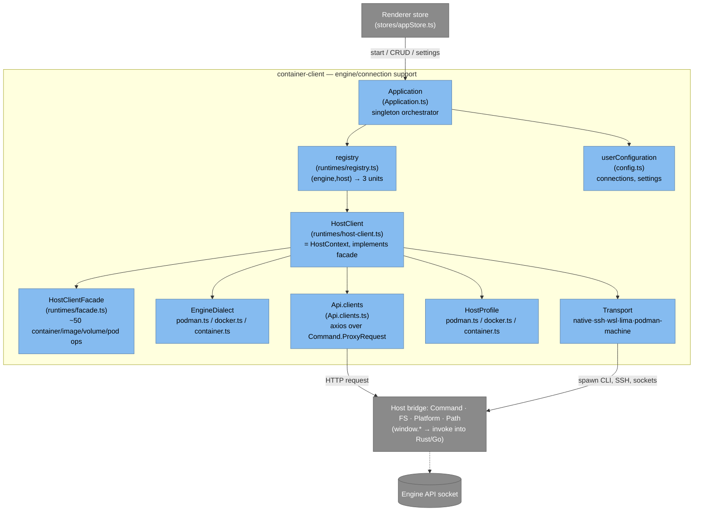

# Backend — Engine & Connection Support (C4 L3)

The "backend" is everything that turns *"connect me to this engine"* into a live,
pingable API the UI can call. It lives in [`src/container-client/`](../../src/container-client/)
and — despite the name — runs **in the webview realm**, reaching the OS through the
`window.*` host ports the shell's bridge installs (see [overview.md](overview.md)).

Its whole job: given a **Connection** (which engine, which host), produce a
**HostClient** that knows how to start the scope, find the engine socket, start
the API, and proxy requests to it.

## The core idea: one HostClient = Dialect × Transport × Profile

There are three engines (Podman, Docker, Apple Container). Podman and Docker each
support five host types (native, machine/vendor, WSL, Lima, SSH-remote); Apple
Container supports two (native, SSH-remote) — twelve combinations. Rather than
twelve inheritance leaves, each combination is **composed** from three
single-purpose units:

| Unit              | Varies by      | Answers                                                                                                        | Source                                                                                                           |
| ----------------- | -------------- | -------------------------------------------------------------------------------------------------------------- | ---------------------------------------------------------------------------------------------------------------- |
| **EngineDialect** | engine         | "How do I speak to _this engine_?" — read its socket, build its service command, get system info               | [`runtimes/dialects/{podman,docker,container}.ts`](../../src/container-client/runtimes/dialects/)                          |
| **HostProfile**   | (engine, host) | the thin glue — OS availability gate, automatic-settings detection, the per-host API-connection resolver       | [`runtimes/profiles/{podman,docker,container}.ts`](../../src/container-client/runtimes/profiles/)                          |
| **Transport**     | host type      | "How do I reach a host of _this kind_?" — start/stop a scope, shape the API URI, run the API, build the driver | [`runtimes/transports/{native,ssh,wsl,lima,podman-machine}.ts`](../../src/container-client/runtimes/transports/) |

A **registry** maps each `(engine, host)` pair to its three units; a factory
assembles them into a `HostClient`. The `HostClient` *is* the `HostContext` passed
back into those units' methods — so a Transport can call back into the engine's
Dialect through `host.dialect`, and vice-versa.

## The components

- **Application** — [`Application.ts`](../../src/container-client/Application.ts).
  The singleton the renderer talks to (`Application.getInstance()`). Owns the
  connection lifecycle (`start`, `stop`, `createConnectorContainerEngineHostClient`),
  connection CRUD, settings, and one-off engine actions (machines, kube, registries,
  security scans). It holds the active `HostClient` per connection id.
- **registry** — [`registry.ts`](../../src/container-client/runtimes/registry.ts).
  The twelve-entry table `HOST_CLIENT_REGISTRY` and `createComposedHostClient()`.
  Stateless dialects/profiles are shared singletons; transports are created
  per-host (SSH/WSL/machine keep per-connection state). See
  [engine-matrix.md](engine-matrix.md) for the full table.
- **HostClient / HostContext** — [`host-client.ts`](../../src/container-client/runtimes/host-client.ts)
  + [`composition.ts`](../../src/container-client/runtimes/composition.ts). The
  composed object that implements the operations facade by delegating to its three
  units. It is passed back into them as `HostContext`, the shared "this".
- **HostClientFacade** — [`facade.ts`](../../src/container-client/runtimes/facade.ts).
  The uniform operations surface the UI consumes (containers, images, volumes,
  networks, pods, secrets, events, plus engine extensions like machines, contexts,
  swarm, compose). Named here, not enumerated — read the interface.
- **EngineDialect / Transport / HostProfile** — the three units above. Their
  contracts are defined once in [`composition.ts`](../../src/container-client/runtimes/composition.ts);
  Native's scope operations are intentional no-ops (symmetry over special-casing).
  The **Apple Container** dialect has no native REST API, so it sets
  `apiSurface: "docker"` and speaks the Docker API through the **socktainer**
  bridge; its `describeApiBridge` folds socktainer's presence/version into the
  availability report.
- **Api.clients** — [`Api.clients.ts`](../../src/container-client/Api.clients.ts).
  `createApplicationApiDriver()` returns an Axios instance whose every request is
  routed through `Command.ProxyRequest(req, connection)` — i.e. HTTP spoken over a
  unix socket / named pipe / SSH tunnel, executed natively in Rust or Go. The
  SSH transport injects a `getSSHConnection` hook so the tunnel comes up lazily on
  first request.
- **userConfiguration** — [`config.ts`](../../src/container-client/config.ts).
  Persisted settings and the saved connection list, read by the host bridge before
  the app mounts.

## Resource data layer (lists + freshness)

The `HostClientFacade` is the raw operations surface; screens don't call it directly. Two layers sit on top:

- **Per-resource adapters** — [`adapters/`](../../src/container-client/adapters/). Each
  (`ContainersAdapter`, `ImagesAdapter`, `PodsAdapter`, `VolumesAdapter`, `NetworksAdapter`,
  `SecretsAdapter`, …) extends [`ResourceAdapter`](../../src/container-client/adapters/shared.ts), which
  binds the active `HostClient`'s Axios driver and the per-engine normalizers. Adapters expose typed
  `list()/start()/stop()/…` over the engine REST API; `getActiveHostClient()` resolves the current host.
- **Resource vocabulary** — [`resourceDomains.ts`](../../src/container-client/resourceDomains.ts): the
  canonical `RESOURCE_DOMAINS`, `ResourceDomain`/`ResourceItemsByDomain` types, and the engine-event →
  domain mapping (`normalizeResourceEventDomains`). Neutral (no Zustand, no shell) so **both** the renderer
  and the engine service import it. The renderer's `resourceEvents`/`resourceStore` consume it (see
  [frontend.md](frontend.md)).

### Service-owned data layer

The **`EngineDataService` is the single engine authority**: it owns the connection, the engine `/events`
stream and all list fetching. The screens run no event manager and open no second connection —
`resourceEvents` is a thin client that starts the mirror and forwards "refresh now" nudges. Engine HTTP
resolves in the native backend, so there is **one** tunnel / relay / socket pool per connection, held in Rust
or Go and surviving a webview reload. Reads are pushed to the stores; the native tray menu is projected from
that same owned data (see [system-tray.md](system-tray.md)).

The service and its clients share the **webview realm**, so their "channels" are direct calls over an
in-memory bus ([`inRealmBus.ts`](../../src/packages/platform/src/inRealmBus.ts)) rather than IPC. The channel
names survive because the store code reads `window.MessageBus` / `window.ResourceBus` ambiently and does not
care which transport is underneath.

| Piece | Path | Role |
| --- | --- | --- |
| `EngineDataService` | [`platform/engineDataService.ts`](../../src/packages/platform/src/engineDataService.ts) | The service over `Application`: connection/runtime + per-connection resource state, initial lists + `/events` -> debounced refresh, plus tray action execution and a machines cache for the native tray menu. Idempotent `ensureConnected`. |
| `ResourceSyncBroker` | [`platform/resourceSyncBroker.ts`](../../src/packages/platform/src/resourceSyncBroker.ts) | Pushes a `ResourceSyncSnapshot` on change; answers `resource:get-snapshot` + awaitable `resource:ensure-connected`; accepts a `resource:refresh` nudge. |
| `resourceSyncHost` | [`tauri/resourceSyncHost.ts`](../../src/packages/platform/src/tauri/resourceSyncHost.ts) · [`wails/…`](../../src/packages/platform/src/wails/resourceSyncHost.ts) | Hosts the service + broker in the realm and wires them to the in-realm bus. |
| `ResourceBus` | [`tauri/resourceBus.ts`](../../src/packages/platform/src/tauri/resourceBus.ts) · [`wails/…`](../../src/packages/platform/src/wails/resourceBus.ts) | Allowlisted receive bridge (mirrors `TrayBus`) for resource pushes. |
| `commandProxyClient` | [`tauri/commandProxyClient.ts`](../../src/packages/platform/src/tauri/commandProxyClient.ts) · [`wails/…`](../../src/packages/platform/src/wails/commandProxyClient.ts) | Invokes `Command.ProxyRequest` through the native engine-API data plane; container-log streams arrive as chunked channel events. |
| `resourceMirror` | [`web-app/stores/resourceMirror.ts`](../../src/web-app/stores/resourceMirror.ts) | Applies the service's pushed snapshots into the **same** `resourceStore` the screens read (the seam). |
| Shared protocols | [`resourceSyncProtocol.ts`](../../src/packages/container-client/src/resourceSyncProtocol.ts) · [`commandProxyProtocol.ts`](../../src/packages/container-client/src/commandProxyProtocol.ts) | Channels + `AppRuntimeSnapshot`/`ResourceSyncSnapshot` + command-proxy payload types. |

The renderer still composes a `HostClient` for typing + per-engine normalizers, but the actual socket work
happens natively — so there is exactly **one** engine connection whether the app window is open, closed
(hidden to tray), or the tray menu is acting on its own.

## Key types (the vocabulary)

All in [`src/env/Types.ts`](../../src/env/Types.ts):

- `ContainerEngine` — `PODMAN | DOCKER | APPLE`.
- `ContainerEngineHost` — the twelve `engine.host` values (e.g. `podman.native`,
  `docker.virtualized.wsl`, `container.native`, `container.remote`).
- `ControllerScopeType` — `PodmanMachine | WSLDistribution | LIMAInstance |
  SSHConnection` (the kind of scope a non-native host runs in).
- `Connection` — a named, identified `(engine, host, settings)` the user picks.
- `Connector` — a `Connection` enriched with discovered `availability` (and
  `scopes`, `capabilities`); this is what the UI lists.
- `EngineConnectorSettings` — `{ api: { baseURL, connection: { uri, relay } },
  program, controller?, rootfull, mode }`, where `mode` is `automatic` or `manual`.
- `EngineConnectorAvailability` — the per-check result (`host`, `program`,
  `controller`, `api`, …) with a human-readable `report`.

## What happens at connect time

The ordered sequence — start scope → detect settings → start API → check
availability — is the subject of its own page:
**[connection-startup.md](connection-startup.md)**.

## Source map

| Component                     | Path                                                                            |
| ----------------------------- | ------------------------------------------------------------------------------- |
| API driver                    | [`Api.clients.ts`](../../src/container-client/Api.clients.ts)                   |
| Composed client               | [`runtimes/host-client.ts`](../../src/container-client/runtimes/host-client.ts) |
| Composition seam (interfaces) | [`runtimes/composition.ts`](../../src/container-client/runtimes/composition.ts) |
| Connector defaults            | [`connection.ts`](../../src/container-client/connection.ts)                     |
| Dialects                      | [`runtimes/dialects/`](../../src/container-client/runtimes/dialects/)           |
| Operations facade             | [`runtimes/facade.ts`](../../src/container-client/runtimes/facade.ts)           |
| Orchestrator                  | [`Application.ts`](../../src/container-client/Application.ts)                   |
| Profiles                      | [`runtimes/profiles/`](../../src/container-client/runtimes/profiles/)           |
| Registry (12 entries)         | [`runtimes/registry.ts`](../../src/container-client/runtimes/registry.ts)       |
| Transports                    | [`runtimes/transports/`](../../src/container-client/runtimes/transports/)       |
| Types                         | [`src/env/Types.ts`](../../src/env/Types.ts)                                    |
