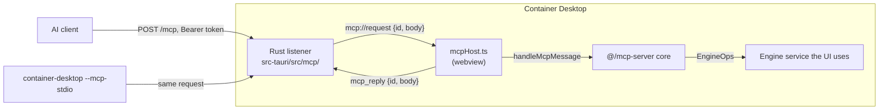

# MCP server

AI clients (Claude Code, Cursor, VS Code) reach the user's engines through the app, over the Model Context Protocol.
Off by default, read-only by default, loopback only. Glossary: [CONTEXT.md](../../CONTEXT.md).

## How a request travels

- The Rust listener owns the socket, the request rules and the token; the webview owns the protocol and the tools.
- Tools run on the same in-realm engine service as the UI, so a change made over MCP shows on screen at once.
- A request waits up to 10 minutes for its answer (a pull can be slow), then gets a 504; a page reload ends the wait
  at once.

## Transport

- Streamable HTTP at `http://127.0.0.1:<port>/mcp`, POST only, JSON answers (no SSE stream); a notification gets 202.
- Default port 17627, set in Settings → MCP server; `DEFAULT_MCP_PORT` lives in `mcpSettings.ts` and `settings.rs`.
- Protocol versions 2025-11-25, 2025-06-18, 2025-03-26 and 2024-11-05; any other `MCP-Protocol-Version` gets a plain 400.
- `container-desktop --mcp-stdio` relays stdio line by line to the running app, reading the port from the settings
  file and the token from the keychain; no GUI starts. Without the app it answers each request with an error.

## Request rules, in order

1. `Host` must be loopback, and `Origin` absent or loopback (the DNS-rebinding guard): else 403.
2. `Authorization: Bearer <token>`, compared in constant time: else 401.
3. Path `/mcp` only (404) and method POST only (405).
4. Body at most 1 MiB: else 413.

## Token

- 32 random bytes as hex, created on first start, kept in the OS keychain (account `mcp-token`).
- Shown and copied in Settings; regenerating it restarts the listener so no old connection survives.
- An isolated run (`CONTAINER_DESKTOP_USER_DATA_DIR`, as the WebDriver harness sets) keeps it in its own data dir.
- No OS keychain: the server stays off and says why; there is no consent setting for file storage yet.

## Modes and tools

- **read-only** (default): `listConnections`, and list or inspect for containers, images, networks and volumes, plus
  container logs and stats.
- **allow** adds the gated tools: start, stop, restart, pause, unpause and remove a container; remove an image, network
  or volume; pull an image. In read-only they are not listed, and a call to one is refused as a tool error.
- The mode is read from the settings for each request, so a change in Settings applies to the next call.
- Tool descriptions live in `src/resources/prompts/mcp-tool-descriptions.md`; every result is passed through the
  secret redactor (`@/utils/redact`) before it leaves the app.

## Where to look

- `src/packages/mcp-server/src/core/`: the protocol, the tool catalogue, argument validation, the modes.
- `src/packages/platform/src/tauri/mcpHost.ts` and `src/packages/platform/src/mcpIpc.ts`: the webview side and the
  Settings channels.
- `src-tauri/src/mcp/`: the listener, its rules, the token, the stdio relay.
- `src/web-app/screens/Settings/panels/McpServerPanel.tsx`: the settings; `webdriver/specs/mcp-server.e2e.js`: the
  end-to-end check.
