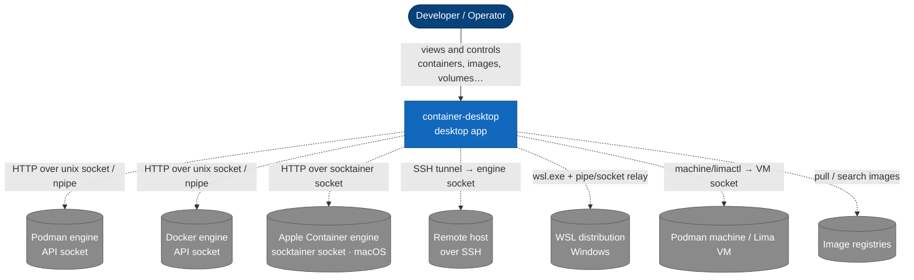
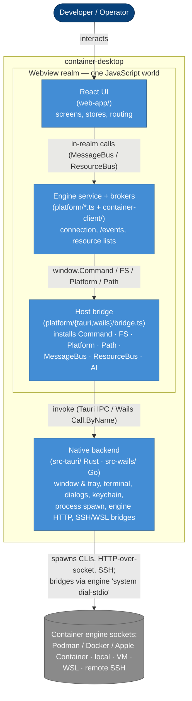

# Overview — System Context & Containers (C4 L1 + L2)

container-desktop is a cross-platform desktop app for managing container engines
(Podman, Docker, and Apple Container), whether they run locally, inside a VM,
inside WSL, or on a remote host over SSH. This page is the big picture; [backend.md](backend.md)
and [frontend.md](frontend.md) zoom in.

## C4 L1 — System Context

Who uses the app and what it talks to.

The app is a **client** of engine API sockets. It never reimplements the engine —
it discovers, starts, and proxies to the engine's REST API (the Podman/libpod,
Docker, or Apple Container socket — the last exposed by **socktainer**), then
renders the results.

## C4 L2 — Containers (runnable pieces)

The app is a TypeScript renderer running in the OS's own **webview**, over a
**native backend** — Rust ([Tauri](https://tauri.app)) or Go
([Wails](https://wails.io)). Both ship; see [`CLAUDE.md`](../../CLAUDE.md) for the
build model. A TypeScript build CLI lives in `support/cli/` (not shown — it
builds, it doesn't run at app runtime).

The interesting part is **where the engine logic runs**: there is exactly **one
JavaScript realm**, the webview. The `container-client` "backend", the engine
service that owns the connection, and the React UI all run in it side by side —
no process boundary between them. Privileged I/O is the native backend's job, and
the webview reaches it by `invoke` through the host bridge.

### The pieces

- **Webview realm** — one JavaScript world holding three collaborators:
  - **React UI** — `src/web-app/` (screens, Zustand stores, TanStack Query/Router).
  - **Engine service + brokers** — `EngineDataService` and `ResourceSyncBroker`
    (`src/packages/platform/src/*.ts`) over the `container-client` engine layer.
    The service is the single owner of the connection, the engine `/events`
    stream and all list fetching (see [backend.md](backend.md)). Because there is
    no process to cross, the brokers and their clients talk over an in-memory bus
    ([`inRealmBus.ts`](../../src/packages/platform/src/inRealmBus.ts)) that the
    bridge exposes as `window.MessageBus` / `window.ResourceBus`.
  - **Host bridge** — [`platform/tauri/bridge.ts`](../../src/packages/platform/src/tauri/bridge.ts)
    / [`platform/wails/bridge.ts`](../../src/packages/platform/src/wails/bridge.ts).
    Installs the `window.*` globals the shared code reads ambiently — `Command`
    (process spawn, `ProxyRequest` = HTTP over a unix socket / named pipe,
    `StartSSHConnection`), `FS`, `Platform`, `Path`, `MessageBus`, the receive
    buses, and `AI` — each backed by an `invoke` into native code. It sets
    `window.Preloaded` **last**, which is the readiness flag the renderer blocks
    on (`Native.ts:waitForPreload`).
- **Native backend** — `src-tauri/` (Rust) and `src-wails/` (Go), at feature
  parity. Owns the window and native tray menu, terminal launch, file dialogs,
  the keychain, process spawn/streaming, the engine HTTP client, and the
  remote-connection data plane. It does the privileged I/O the webview cannot.
- **Socket bridge (native)** — for hosts whose engine socket isn't locally
  reachable, the backend runs a local listener (unix socket, or a Windows named
  pipe) and, per incoming connection, spawns the engine's own
  `docker`/`podman system dial-stdio` — over `wsl.exe --exec` for a WSL distro
  (no SSH server needed inside it) or over `ssh` for a remote host — shuttling
  raw bytes both ways. Linux/macOS remote SSH can instead use a long-lived
  `ssh -NL` port forward. Both kinds live in
  [`bridge.rs`](../../src-tauri/src/bridge.rs) / [`bridge_service.go`](../../src-wails/bridge_service.go),
  keyed and cached so a webview reload never tears a live connection down. See
  [connection-startup.md](connection-startup.md).
- **External engines** — Podman/Docker REST sockets, plus Apple Container's
  Docker-compatible socket exposed by **socktainer** (macOS/Apple-silicon),
  reachable directly (native), through a VM (machine/Lima), through WSL, or across SSH.

### Build/runtime note (don't relearn the hard way)

`yarn build` emits **one** bundle, the ESM renderer — the native side is compiled
by `cargo` or `go`, not by vite. Production needs `ENVIRONMENT=production`. The
renderer's browser baseline is the real webview floor (`safari 17` + `chrome 120`),
not a bundled browser version. Full details live in
[`CLAUDE.md`](../../CLAUDE.md) → *Build / runtime model*; they are not repeated
here.

## Source map

| Piece | Path |
| --- | --- |
| Tauri backend (Rust) | [`src-tauri/src/`](../../src-tauri/src/) |
| Wails backend (Go) | [`src-wails/`](../../src-wails/) |
| Host bridges | [`tauri/bridge.ts`](../../src/packages/platform/src/tauri/bridge.ts) · [`wails/bridge.ts`](../../src/packages/platform/src/wails/bridge.ts) |
| Host ports (OS / FS / path) | [`tauri/host.ts`](../../src/packages/platform/src/tauri/host.ts) · [`wails/host.ts`](../../src/packages/platform/src/wails/host.ts) |
| Command facade | [`tauri/command.ts`](../../src/packages/platform/src/tauri/command.ts) + [`tauri/exec/`](../../src/packages/platform/src/tauri/exec/) |
| In-realm bus | [`inRealmBus.ts`](../../src/packages/platform/src/inRealmBus.ts) |
| Engine service | [`engineDataService.ts`](../../src/packages/platform/src/engineDataService.ts) |
| Engine logic (backend) | [`src/packages/container-client/`](../../src/packages/container-client/) |
| React renderer (frontend) | [`src/web-app/`](../../src/web-app/) |
| Platform-port naming | [`platform-ports.md`](platform-ports.md) |
| Socket bridge / tunnels | [`bridge.rs`](../../src-tauri/src/bridge.rs) · [`bridge_service.go`](../../src-wails/bridge_service.go) |
